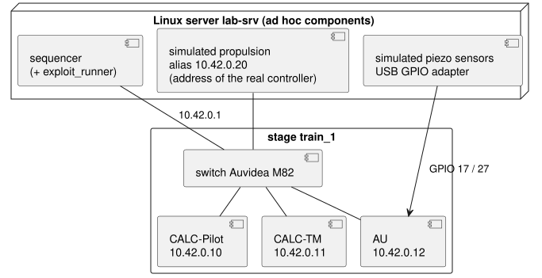

# Toy train: a test environment built on testsuit

The example project of testsuit: the test environment of a small system, a toy train. Everything here is example code, configuration and sample data you can copy as a starting point. The system itself is not implemented, only the tools and configuration around it.

It has two parts:
- **the `toytrain` package**, a Python library extending testsuit without changing it: file formats for the train's recordings, mexploit criteria, a datapack importer for its software releases, a report logo and a command-line tool;
- **the test configuration**, run by the [sequencer](../../src/testsuit/sequencer/README.md): lab inventory, component types, datapack setup, test definitions with their pipeline, and exploitation criteria. The [sequencer cheat sheet](../../src/testsuit/sequencer/README.md#cheat-sheet) shows how to build, post and follow these datapacks.

## The system under test

An autonomous toy train that only goes forward or backward. It has a speed limit of 0.5 m/s, although its propulsion can reach 1 m/s. Two piezo sensors, front and back, detect contacts with obstacles.

The pilot runs at 0.25 m/s for 5 s, then goes up by steps of +0.1 m/s until it reaches the speed limit. When it detects a contact, it stops the train.

| Equipment | Hardware | Role |
|---|---|---|
| CALC-Pilot | Arduino UNO Q, Ethernet through a W5500 | pilot: sends speed commands, reacts to contacts |
| CALC-TM | Raspberry Pi 5 | telemetry: records the system data into a local file |
| AU | Raspberry Pi 5 | acquisition unit: reads the piezo sensors on its GPIO |
| Switch | Auvidea M82 | Ethernet network of the train |
| Propulsion controller | home made, Ethernet | accepts `up`, `down`, `stop`, `keep`, and sends back the current speed. Its battery powers the other equipment |

## The lab



- **One stage**, `train_1`, holds CALC-Pilot, CALC-TM, AU and the switch. They are locked together.
- **The Linux server** hosts three ad hoc components: the sequencer itself, never locked, which also runs the exploitation, and the two simulations.
- **The simulated propulsion controller** answers on the real controller's address, so the calculators run with exactly the configuration they use on the real train.
- **The simulated piezo sensors** pulse the AU GPIO inputs through a USB GPIO adapter. A contact can be triggered on a condition on the speed feedback, for example 3 s after full speed is reached.

## Test scenarios

| Test | Scenario | Checked by the exploitation |
|---|---|---|
| [max_speed](datapack/testdef/max_speed/testdef.yml) | the train accelerates for 30 s, with no obstacle | the speed never exceeds 0.5 m/s (5 mm/s tolerance); the speed is 0.25 m/s during the first 5 s; the limit is reached; no contact |
| [front_contact](datapack/testdef/front_contact/testdef.yml) | a front contact 3 s after full speed is reached | full speed during the 3 s before the contact; `stop` commanded within 0.2 s; standstill within 1 s; the train does not move again; the speed limit is never exceeded |

Both tests share the setup and the pipeline. Only their scenario dictionary and their criteria differ.

## Files

```
pyproject.toml                         package, entry point: [project.entry-points."testsuit.plugins"]
src/toytrain/
  plugin.py                            register(): every registration, in one place
  filemgrs.py                          file managers (readers)
  criteria.py, checks.py               mexploit criteria
  importer.py                          datapack importer
  cli.py                               the toytrain command
  assets/toytrain_logo.svg             report logo
lab/                                   owned by the lab operators
  toytrain_lab.yml                     inventory: stage train_1, ad hoc components on lab-srv
  types/toytrain.yml                   lab types: arduino_unoq, rpi5, auvidea_m82, toytrain_sim
  toytrain_emulated.yml                inventory of the emulated mode: everything on the dev host
  types_emulated/toytrain.yml          the same type names, as local processes
datapack/                              owned by the test authors
  setup/toytrain_setup.yml             test component types (extending the lab types), inputs, resources
  setup/globals.yml                    train characteristics, network plan, versions
  setup/platforms/<configuration>.yml  what the platform changes: sim_bench (the lab), emulated (dev host)
  setup/templates/                     configuration of each component, rendered by the datapack tool
  testdef/<test>/testdef.yml           test definition and pipeline
  testdef/<test>/scenario.yml          scenario keys
  testdef/<test>/criteria/<test>/      exploitation criteria (mexploit)
  release_store/                       stand-in for the release server (toytrain-release importer)
baseline_expected.yml                  expected baseline of the campaign
tsq.yml                                main configuration of the lab's sequencer
tsq.dev.yml                            main configuration of a sequencer on a dev host (emulated mode)
sample/
  data/<test>/                         recordings of a nominal run: telemetry.csv, propulsion.propj
  exploit_<test>.yml                   exploit_runner session: the test's criteria on its recording
  make_runs.py                         how the recordings were made
tests/                                 pytest suite, runs everything end to end
```

## What the package adds to testsuit

| What | Where | Used as |
|------|-------|---------|
| a new data file format, the JSON record of the propulsion controller | `filemgrs.PropulsionJsonFileMgr` | `*.propj` files |
| a fake format whose signals are generated, not measured | `filemgrs.SimulatedFileMgr` | `*.sim.yml` files |
| a CSV syntax, the CALC-TM telemetry (a `#TOYTRAIN-TM` line on top of a CSV file) | `filemgrs.TelemetryCsvFileMgr` | `*.csv` files starting with `#TOYTRAIN-TM` |
| mexploit criteria registered as a module | `criteria.py` | `type: within_range`, `max_slope`, `settles` |
| mexploit criteria registered one by one (`@register_criterion`) | `checks.py` | `type: no_dropout`, `mean_close_to` |
| a datapack importer | `importer.ReleaseImporter` | `importer: toytrain-release` in datapack setups |
| its own logo on the exploit_runner HTML report | `assets/toytrain_logo.svg` | every report |
| a command-line tool | `cli.py` | `toytrain` |

All of it is registered in one function, `plugin.register()`, which `pyproject.toml` declares as a `testsuit.plugins` entry point. Once the package is installed, testsuit calls it by itself: in your scripts, in the command-line tools (`data2h5`, `mxp`, `exploit_runner`, `datapack`...), and in the `mxp` processes exploit_runner starts for each test run.

## Install

From the root of the testsuit repository:

```bash
pip install -e .                               # testsuit
pip install -e "examples/toytrain[test]"       # this example
```

Outside this repository, install testsuit from Git instead: `pip install "testsuit @ git+https://github.com/laurentmldev/testsuit"`.

Check that testsuit sees the plugin:

```bash
python -c "from testsuit.plugins import load_plugins; print(load_plugins())"    # ['toytrain']
```

## Try it

Commands below run from `examples/toytrain`. Outputs go to `.work/`, which Git ignores.

**Load the recordings** like any other testsuit format:

```bash
data2h5 sample/data/max_speed -l                                # the parameters of every file
data2h5 sample/data/max_speed .work/max_speed.h5 -p ".*"        # all of them into an HDF5 file
```

```python
from testsuit.datatools.DataFileMgrs.FolderParamMgr import FolderParamMgr
from testsuit.misc.MonitorProgress import MonitorProgress

scanner = FolderParamMgr("sample/data/max_speed")
[speed] = scanner.findParams("^speed_mps", monitorProgress=MonitorProgress(name="demo"))
```

**Run the criteria of a test** on its sample recording, as the exploit phase of the pipeline would. The report, `.work/exploit_max_speed/exploit_synthesis.html`, starts with the toy-train logo:

```bash
exploit_runner sample/exploit_max_speed.yml
exploit_runner sample/exploit_front_contact.yml
```

A single test run works with mxp too: `mxp datapack/testdef/max_speed/criteria/max_speed sample/data/max_speed -o .work/mxp -f`.

**Build a datapack.** The software and simulation datasets come from the release store (`datapack/release_store`). `--nocheck` is needed because the example folders are not a tagged Git checkout:

```bash
datapack datapack/testdef/max_speed/testdef.yml --nocheck
```

The datasets are imported into `.work/datarepo`, the templates of `datapack/setup/templates` are rendered for each component, and the zip lands in `.work/datapacks`, ready for `tsq submit`. Run it again and the datasets are checked (version and checksums) instead of being imported again.

**Use the `toytrain` command**, installed with the package (`[project.scripts]` in pyproject.toml):

```bash
toytrain info sample/data/max_speed                 # data files, the reader of each one, their parameters
toytrain criteria --templates                       # the criteria this package adds, with their scenario syntax
toytrain check sample/data/max_speed max_slope "^speed_mps" max_per_sec=0.55     # one criterion, no scenario needed
toytrain import datapack/release_store/toytrain-sw v0.3.0 .work/toytrain_sw/v0.3.0
```

`check` runs any criterion registered by a plugin on one parameter (a regex matching a single one), with the criterion settings given as `key=value`. It prints `OK` or `FAILED` with the reason and exits with 0, 1, or 2 on a usage error, so it fits in shell scripts. `import` fetches a dataset version like datapack does; on a folder already imported, it checks the version and checksums instead.

**Run the tests**: `pytest`.

## A run on the lab (sequencer)

```
datapack datapack/testdef/front_contact/testdef.yml        # build the zip (inputs, keys, pipeline, baseline)
tsq submit .work/datapacks/toytrain_front_contact_*.zip --baseline baseline_expected.yml --wait --follow
```

Before anything else, the sequencer self-tests every component it locks: SSH, target folders, disk space and clock for the Linux systems, plus the microcontroller link of CALC-Pilot, the simulation's address and GPIO adapter on lab-srv, and a ping of the switch. A failure puts the datapack back in the queue.

The pipeline then has two phases, the first one built from two sub-pipelines.

**test_run** locks the stage `train_1` and the two simulations, then:
1. `bring_up`: deploys every input in parallel, and flashes the CALC-Pilot microcontroller; starts the simulations, then CALC-TM and AU, each waiting for its `READY` log line; starts the pilot once everything listens (rendez-vous), and waits for its monitored state to be `running`;
2. lets the scenario run for its duration;
3. `shut_down`: stops the pilot first, then the rest;
4. finally collects every output (`telemetry.csv`, `propulsion.propj`, `piezo.csv`, logs), even after a kill.

**exploit** runs on the lab server. It receives these outputs as inputs and runs `exploit_runner` on the criteria. Exit code 0 means the verdict is `succeeded`; any other exit code means `failed`.

Everything collected joins the results datapack, next to the inputs. Its baseline carries the git tags of the software and simulation, the lab inventory version, and the software version read on each calculator. A mismatch with `baseline_expected.yml` flags the run as non-conform.

## Emulated mode on a dev host

The same tests can run with the whole platform emulated on one Linux computer, with no hardware, no root access and no SSH. This is meant for writing and debugging tests and pipelines, and for a demonstration of the sequencer. A full run needs host builds of the toy-train applications and simulations; the release store only holds placeholders, so a run ends in `error` at the self-test.

```
datapack datapack/testdef/front_contact/testdef.yml --nocheck --setup-config emulated
tsq --config tsq.dev.yml run .work/datapacks/toytrain_front_contact_toytrain_setup_*.zip --local
```

What changes, and what does not:
- **The datapack** is built from the same test definitions and setup. Only the setup configuration differs: `emulated` adds the dictionary `platforms/emulated.yml`, which moves every address to the loopback interface (`127.0.0.10` to `127.0.0.30`). Linux routes all of `127.0.0.0/8` to it, multicast included, so this needs no network setup. Ports and the multicast group are unchanged.
- **The lab** is `lab/toytrain_emulated.yml`. Its stage `train_emu` has the type `toytrain` and the roles pilot, telemetry and acquisition, so the datapack binds to it unchanged. Every component uses the `local` transport, under `~/.toytrain-emu/`.
- **The component types** in `lab/types_emulated/` keep the lab's type names. Each application runs as a plain process started by the sequencer, from the inputs it deployed, and is stopped with a signal. There is no systemd service and no sudo.
- **The hardware** is simplified away:
  - the CALC-Pilot microcontroller is replaced by its host stub (`--mcu host`), so flashing only checks the firmware image;
  - the AU GPIO inputs are replaced by UDP datagrams from the piezo simulation, in place of the USB GPIO adapter;
  - there is no switch, since the loopback interface is the train network;
  - the propulsion and piezo simulations are the same as on the lab.
- **Exploitation** is the same, with `exploit_runner` on the dev host.

A run in emulated mode is flagged non-conform against `baseline_expected.yml`, since its lab is not a tagged lab repository. Its results can therefore never be taken for a lab run.

## Assumptions

Interfaces assumed for this example, all belonging to the toy-train software:
- each calculator runs a systemd service `toytrain-<role>`, configured from `<remote_root>/<component>/input/`, that logs `READY` when listening;
- CALC-Pilot has an `install` helper that flashes its microcontroller;
- messages are UDP. Commands go to the propulsion controller on port 5000. Speed feedback (20 Hz), contact events and pilot state are multicast on 239.42.0.1, ports 5001 to 5003;
- the telemetry file is a CSV with a `#TOYTRAIN-TM` first line and columns `Time, speed_mps, pilot_cmd, pilot_state, contact_front, contact_back` (`pilot_cmd`: 0 keep, 1 up, 2 down, 3 stop; `pilot_state`: 0 idle, 1 running, 2 stopped);
- the propulsion controller and its simulation record what they receive and send as `*.propj` JSON files;
- the switch is unmanaged: it is only monitored (ping), and locked with its stage. The datapack does not drive it, so it has no component in the setup;
- each application sends and joins its multicast traffic on the interface of its `local_address`;
- the applications are Python, so the same release runs on the calculators and on a dev host; each one is started as `app/bin/toytrain-<role> --config <role>.yml`;
- in emulated mode, the pilot accepts `--mcu host` (microcontroller host stub), the AU accepts `--gpio-backend udp://<address>:<port>` (one datagram per GPIO edge), and the piezo simulation's `--gpio` accepts the same URL in place of the adapter device.

This sample also uses a few details that the sequencer README leaves open:
- a probe state can be matched on an exit code (`exit: 0`);
- host variables are reachable as `component.vars.*`, with `component.output_dir` next to `component.input_dir`;
- `install` and `version` are ordinary named commands;
- `wait_for: {state: ...}` names its component.

The datapack tool keeps the sequencer fields (`extends`, `stages`, `stage`, `role`, `commands`, `pipeline`) in the datapack as written, for the sequencer to use.

## Writing your own

**A file format.** Subclass `AFileMgr`: `getFieldNames()` lists the parameters of a file, `loadParams()` returns the requested ones as pandas objects indexed by seconds since epoch, each passed through `self.finalizeParam(...)`. When your format can be read whole, `filemgrs.ChannelsFileMgr` shows the shortest path: implement `readChannels()` only. Then register it:

```python
register_file_format("propulsion-json", ["propj"], PropulsionJsonFileMgr)
```

Extensions can contain dots (`"sim.yml"`), and `accepts=lambda filename: ...` narrows a format to some of the files with its extensions. For a CSV dialect, subclass `CsvFileMgr` and register a detector instead: `register_csv_variant("toytrain-telemetry", isTelemetryCsv, TelemetryCsvFileMgr)`.

**A criterion.** A function `crit_<type>(critConf)` that raises (usually with `assert`) when the check fails. `critConf` is the scenario entry, with its `name` and `type`. Load data with testsuit's `param()` helper, or read an earlier `computed_param` entry, as `criteria.signal()` does. Register a whole module with `register_criteria_module("mylib.criteria")`, or single functions with `@register_criterion`. A docstring with a `<TEMPLATE>` block, as in testsuit's own criteria, documents the scenario syntax.

**A datapack importer.** Subclass `ADataImporter` (`retrieve()`, `checkVersion()`, `getChanges()`, `getTag()`) and register the class, or any factory `(targetDir, remotePath, versionId)`: `register_data_importer("toytrain-release", ReleaseImporter)`. The datapack tool provides `<dataset id>.path` and `<dataset id>.version`; after `retrieve()`, the dataset folder can also hold a `dataset.yml` file with more keys for the datapack files (`{{ toytrain_sw.pilot_version }}`).

**The report logo.** `set_default_report_logo(svg=...)` takes SVG markup or a file path; `title="..."` keeps testsuit's animated logo with your name in it. For one run only, use `exploit_runner --report-logo logo.svg` or `--report-logo-title "Toy Train"`.

**A command.** Declare it in `[project.scripts]` (`toytrain = "toytrain.cli:main"`) and call `testsuit.plugins.load_plugins()` before using testsuit, so that your command sees the same formats and criteria as testsuit's own commands.

Without installing your package, `TESTSUIT_PLUGINS=toytrain.plugin` in the environment does the same as the entry point. See the "Extending testsuit from another library" section of testsuit's CONTRIBUTING.md for the reference.
