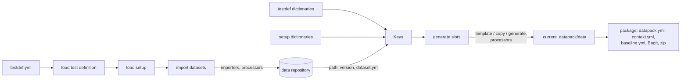

# datapack: test inputs, generated and packaged

The `datapack` command turns a **test definition** into a **datapack**. A datapack is a zip that holds the input files of every slot the test needs, generated from templates, imported datasets and YAML keys, plus a record of where each one comes from. It is self-sufficient: running it, by hand or with the [test sequencer](../../sequencer/README.md), needs nothing but the zip.

[examples/toytrain/datapack](../../../../examples/toytrain/datapack) is a complete example: a setup with three calculators and two simulations, and two test definitions.

## Usage

### Build a datapack

```sh
datapack testdef/max_speed/testdef.yml
```

| Option | What it does |
|---|---|
| `--nocheck` | Accept test definition and setup folders that are not a clean git tag, and datasets whose version cannot be confirmed. The datapack is named `..._DRAFT` and is not conform. |
| `-o, --output-dir DIR` | Where to write the zip (default: the key `datapack.output_dir`). |
| `-c, --setup-config NAME` | Use another configuration of the setup than the test definition's `setup_config`, for example to build the same test for another platform (`--setup-config emulated`). |
| `--lenient` | Skip, with a warning, the inputs whose source is missing or empty (implies `--nocheck`). The skipped inputs are listed in `datapack.yml`. |
| `--baseline EXPECTED` | Compare the new datapack with an expected baseline and report each difference (section [Baseline](#baseline)). |

The contents are also left unzipped in `.current_datapack/` next to the test definition, to look at them.

### Check a datapack

```sh
datapack --verify  build/max_speed_..._20261104_101500.zip                       # checksums intact?
datapack --check-baseline baseline_expected.yml build/max_speed_..._20261104_101500.zip   # conform?
```

Both return 1 when something is wrong, so they fit in a CI job.

### From Python

```python
from testsuit.datatools.datapack.datapack_tools import datapack, verify_datapack, read_baseline

zip_path = datapack("testdef/max_speed/testdef.yml", nocheck=True, setup_config="emulated")
assert not verify_datapack(zip_path)
print(read_baseline(zip_path)["datapack"]["conform"])
```

`datapack()` raises `DatapackError` with a message that names the file and the field at fault.

## The files a test author writes

A test definition names its setup and the setup configuration it uses:

```yaml
# testdef/max_speed/testdef.yml
id: toytrain_max_speed
name: Max speed
setup_file: ../../setup/toytrain_setup.yml
setup_config: sim_bench
dictionaries: [scenario.yml]           # its own keys, relative to this file
pipeline: ...                          # for the test sequencer: kept as written, not rendered
```

A setup describes what a family of tests needs:

```yaml
# setup/toytrain_setup.yml
id: toytrain_setup
dictionaries: [globals.yml]            # shared keys, relative to this file

datarepositories:                      # datasets imported before generating, by an importer
  - id: toytrain
    path: "{{ setup.path }}/../.work/datarepo"
    purge_after_days: 90                # datasets no datapack used for 90 days are deleted (default; 0: never)
    datasources:
      - id: software
        importer: toytrain-release      # registered by a plugin; built in: git
        source: "{{ setup.path }}/../release_store/toytrain-sw"
        datasets:
          - id: toytrain_sw
            version: "{{ toytrain_sw_version }}"
            postprocess: [finalize]     # processors run on the imported folder

slot_types:                            # the inputs of each kind of slot, by configuration
  pilot_app:
    configurations:
      standard:
        inputs:
          - source: templates/pilot.yml            # rendered with Jinja2 (method: template, the default)
            target: pilot.yml
          - source: "{{ toytrain_sw.path }}/pilot/" # copied as is
            target: app/
            method: copy
          - source: templates/profile.yml          # produced by a generator
            target: profile.bin
            method: generate
            generator: profile-compiler   # a registered generator (illustrative)
            options: {step_mps: 0.05}

configurations:                        # what a test uses: its slots, of these types
  sim_bench:
    stage_slots: {train: {type: toytrain}}  # for the test sequencer: slots bound in one lab stage
    slots:
      pilot:     {name: CALC-Pilot, type: pilot_app, configuration: standard, stage_slot: train, role: pilot}
      telemetry: {type: telemetry_app, configuration: standard, stage_slot: train, role: telemetry,
                  needs: [pilot]}      # generated after pilot, can read its inputs
```

`stage_slots`, `stage_slot`, `role`, `tags` (on a slot or a stage slot: the lab component or stage must have them all) and the test definition's `pipeline` are for the test sequencer: the datapack tool checks them and keeps them as written. The role binds a slot to a lab component, and the lab role gives its commands; a stage slot groups slots that must be bound in the same lab stage ([sequencer README](../../sequencer/README.md), sections 7 and 8). A setup's slot types therefore only declare inputs: `extends` and `commands` there are refused, with what to write instead.

The former names are refused, with the current one: `component_types` (now `slot_types`), a configuration's `components` (now `slots`), `stages` and `realms` (now `stage_slots`), a slot's `stage` and `realm` (now `stage_slot`).

[model.py](model.py) holds the schemas of both files. Unknown fields are errors, to catch typos.

### Keys

Every string of these files, and every template, can use keys with Jinja2: `{{ train.speed_limit_mps }}`, ``, loops and filters. Keys come from YAML dictionaries, in this order, each overriding the ones before:

1. the setup's `dictionaries`;
2. the imported datasets: `<dataset id>.path` and `<dataset id>.version`, plus the keys of a `dataset.yml` in the dataset folder when the importer or a processor writes one;
3. the test definition's `dictionaries`;
4. the built-in keys, which always win:
   - `testdef.{id, name, file, path, setup_file, setup_config}`;
   - `setup.{id, name, file, path, configuration}`;
   - `datapack.{name, user, host, timestamp, nocheck}`;
   - while the files of a slot are rendered, `slot.{id, name, type, configuration, input_dir}` and, for the slots it `needs`, `slots.<id>.input_dir`.

A key can reference other keys (`output_dir: "{{ testdef.path }}/../datapacks"`), resolved on first use, so a dictionary may reference one loaded after it. A value made of a single expression keeps its type, so lists and numbers can be shared too. An undefined key is an error, and so is a circular reference. A dotted name (`bench.version: v1.2`) is read as nested keys.

### Inputs

Each input of a slot type puts `source` at `target` in the slot's input folder:

| `method` | What it does |
|---|---|
| `template` (default) | Renders the file, or every file of a folder, with the keys. |
| `copy` | Copies the file or folder as it is. |
| `generate` | Runs a generator: a registered one (`register_generator`), or a script of the setup folder called as `<script> <source> <target> <keys.json>`. |

- `source` is a file, a folder or a glob pattern, absolute or relative to the test definition folder, then to the setup folder. A glob always gives a folder.
- `optional: true` skips an input whose source does not exist.
- `postprocess` runs processors on the target. Built in: `replace s/<regex>/<replacement>/<flags>`.
- A slot whose inputs depend on another's lists it in `needs`. It is generated after it, and reads its files with `read_input('<id>/<file>')` in a template.

## The datapack

The zip follows the BagIt layout (RFC 8493), so it can be checked with standard tools:

```
<testdef id>_<setup id>_<user>_<date>_<time>[_DRAFT]/
  bagit.txt, bag-info.txt
  manifest-sha256.txt, tagmanifest-sha256.txt   checksums of everything
  datapack.yml        what it was built from: test definition, setup and configuration, git state,
                      datasets, each slot's inputs, and the keys each generated file used
  context.yml         every key, resolved: using the datapack needs no dictionary
  baseline.yml        where the contents come from, and whether the datapack is conform
  definition/         the test definition, setup and dictionaries, as written
  data/<slot>/input/         the generated files
  data/<slot>/output/        empty, for the results
```

### Baseline

`baseline.yml` records:
- the sources: the git origin, commit, tag and cleanliness of the test definition, the setup and each dictionary, and the version of each dataset;
- the tools that processed them, with their versions;
- each generated file, with its checksum and what produced it.

A datapack is **conform** when it was built without `--nocheck`, from clean git tags, with every dataset version confirmed.

An **expected baseline** has the same structure and holds only what must match. A string is a shell pattern (`v1.4.*`), and a value starting with a comparison compares versions (`>=3.2`). A mismatch never stops anything: the datapack, or a run of it, is flagged non-conform. The sequencer adds a `run` part to the baseline of the results.

## Architecture



A build runs in four steps, in `_Builder.build`:

1. **Test definition.** The test definition's dictionaries are loaded, then the file is rendered with them and validated. Its `pipeline` is kept as written.
2. **Setup.** The setup's dictionaries are loaded. Each dataset of its data repositories is imported into `<repository path>/<dataset id>/<version>/`. When that folder already exists, its version is checked instead, and a version that cannot be confirmed is an error unless `--nocheck` is given. Each dataset used is marked as such (a `.<version>.last_used` file next to its folder); then the dataset folders of the repository that no build used for `purge_after_days` days (90 by default, `0` to keep them all) are deleted, and downloaded again if a later build needs them. A folder downloaded before these marks existed starts counting at the first build that sees it. The setup is then rendered and validated.
3. **Slots.** The slots of the configuration are generated in the order of their `needs` (a cycle is an error). For each slot, its inputs are rendered, copied or generated into `data/<slot>/input/`, and the keys each file read are recorded.
4. **Packaging.** `datapack.yml`, `context.yml` and `baseline.yml` are written, the BagIt manifests are computed, and the folder is zipped into `datapack.output_dir`.

| Module | Role |
|---|---|
| [datapack_tools.py](datapack_tools.py) | The build (`datapack()`, `_Builder`), dataset import, BagIt and zip, `verify_datapack()`, `read_baseline()`. |
| [model.py](model.py) | Pydantic schemas of the test definition and the setup. |
| [templating.py](templating.py) | `Keys`: layered YAML dictionaries, lazy resolution, Jinja2 rendering with the keys each file used. Shared with exploit_runner. |
| [importers.py](importers.py), [ADataImporter.py](ADataImporter.py), [GitImporter.py](GitImporter.py) | The importer registry, the importer interface (`retrieve`, `checkVersion`, `getTag`, `getChanges`, optional `listVersions`), and the built-in `git` importer. |
| [processors.py](processors.py) | Processors run on an imported dataset or a generated input: built-in `finalize` and `replace`, registered ones, or scripts. |
| [generators.py](generators.py) | Generators for `method: generate`: registered functions, or scripts given the keys as JSON. |
| [baseline.py](baseline.py) | Tool versions and the comparison with an expected baseline. |
| [procs.py](procs.py) | Runs scripts with their output in the tool's log (the terminal, or the sequencer's live log). |

The command line is in [cli/datapack.py](../../cli/datapack.py). The sequencer's Editor uses the same `_Builder` for its key and template previews, so they match a real build.

## Extending it

A library adds importers, processors and generators with these functions, called from its plugin entry point (see [plugins.py](../../plugins.py)):

```python
from testsuit.datatools.datapack.importers import register_data_importer
from testsuit.datatools.datapack.processors import register_processor
from testsuit.datatools.datapack.generators import register_generator

def register():
    register_data_importer("myserver", MyServerImporter)    # importer: myserver
    register_processor("strip", strip_comments)              # postprocess: [strip]
    register_generator("compile", compile_profile)           # method: generate, generator: compile
```

- **Importer.** A factory `(target_dir, source, version) -> ADataImporter`.
- **Processor.** A function `(target: Path, *args: str)`.
- **Generator.** A function `(source, target, keys, options, slot)`. The keys it reads are recorded in `datapack.yml`, like those of templates.

[examples/toytrain/src/toytrain/plugin.py](../../../../examples/toytrain/src/toytrain/plugin.py) registers the `toytrain-release` importer this way.
