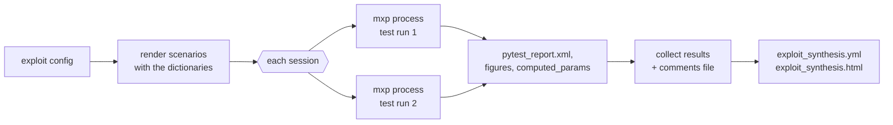

# exploit: checking recorded test data

The `exploit` package checks the data recorded during a test against criteria written in YAML: corridors, sequences of events, comparisons, computed parameters and plots. It has two layers:

- **mexploit** (command `mxp`) runs one **scenario**, a folder of `*.mexploit.yml` files, on one or more data folders. Each entry of a scenario file is a check, run as a pytest test case.
- **exploit_runner** runs many scenarios over whole test **sessions**, each in its own `mxp` process, and gathers them in one HTML report that a reviewer can annotate.

Both read any data format testsuit knows (CSV, TDMS, MDF, DXD, UDBF, HDF5, InfluxDB, ClickHouse, and the formats plugins add), through [FolderParamMgr](../datatools/DataFileMgrs/FolderParamMgr.py). In the [test sequencer](../sequencer/README.md), the exploit phase of a pipeline is an `exploit_runner` step (section 8.3 there).

The scenarios under [tests/etc/mexploit/scenarii](../../../tests/etc/mexploit/scenarii) are working examples of every check type. [examples/toytrain](../../../examples/toytrain) adds project criteria and runs them from a datapack.

## Usage

### Run a scenario

```sh
mxp tests/etc/mexploit/scenarii/mxp_OK_main_functions tests/etc/data -o out/ -f
```

| Option | What it does |
|---|---|
| `-o, --output_folder DIR` | Where to write the results (default `./mexploit_result`). |
| `-f, --force` | Replace an existing results folder. Without it, an existing folder is an error. |
| `-t, --title TITLE` | Title of the report (default: the scenario folder name). |
| `-d, --debug` | Debug messages, also on the console. |
| `--minDate`, `--maxDate` | Keep only the data after, or before, this date (`'2027/06/11 12:32:45.012'` or seconds). |
| `--shiftDateSec S` | Shift the dates of the loaded parameters by S seconds, or by the values of a parameter when S is a parameter name. |
| `--shiftDateRegex F::P` | Apply `--shiftDateSec` only to the parameters matching `<file regex>::<param regex>`. |
| `--plot-backend`, `--figure-format` | Plot backend (`plotly`, `matplotlib`) and figure format, unless a check sets `rendering_engine` or `figure_format` ([root README](../../../README.md#plots)). |

Any other argument is passed to pytest, for example `-k corridor` to run only some checks. `mxp` returns 0 when every check passes, 1 when one fails, and 255 when the analysis itself could not run.

The results folder holds:

```
mexploit.log                     the analysis log
pytest_report.html               the checks, their logs and figures
pytest_report_files/              the pages drawing its plotly figures
pytest_report.xml                the same in JUnit format (read by exploit_runner)
pytest.log
figures/<check>/                 the figures of each check
computed_params/                 computed_params.yaml and one .h5 file per computed data series
```

### Run sessions

```sh
exploit_runner tests/etc/exploit_runner/exploit_config_OK.yml
exploit_runner -s session_01 config.yml                   # only some sessions
exploit_runner --report -c my_comments.yml config.yml     # report again, with a reviewer's comments
```

| Option | What it does |
|---|---|
| `-s, --session NAME` | Run only this session (repeatable). |
| `-r, --report` | Build the report from the existing results, without running anything. |
| `-c, --comments_file FILE` | Add a reviewer's comments and verdicts to the report (section [Review](#review)). |
| `-e, --editable` | Make the HTML report editable: comments and verdicts typed in it are saved as a comments file. |
| `--override-results-path`, `--override-min-date`, `--override-max-date` | Replace `results_path`, `minDate` or `maxDate` of the configuration. |
| `--results_root_folder`, `--file_server_url` | Where results are served from, to print a link to the report. |
| `--report-logo SVG`, `--report-logo-title TITLE` | Logo of the HTML report, or the title drawn in the default one. |
| `--plot-backend`, `--figure-format` | Same as for `mxp`, for every run. |

`exploit_runner` returns 0 when every session succeeds, 1 when a check fails, and -1 when a session could not run. The report is written in every case, with the errors met.

### From Python

```python
from testsuit.exploit.mexploit.mexploit import mexploit
from testsuit.exploit.runner.exploit_runner import exploit_runner

rc = mexploit("tests/etc/mexploit/scenarii/mxp_OK_main_functions", "tests/etc/data", "out/", force=True)
rc = exploit_runner("tests/etc/exploit_runner/exploit_config_OK.yml", custom_dico={"ts01.event02.max_val": 3})
```

`exploit_runner()` also takes the overrides of the command line, `custom_dico` (keys that override the dictionaries), `custom_info` (rows added to the report header) and a `monitorProgress` to follow the run.

## Scenarios

A scenario is a folder of `*.mexploit.yml` (or `.yaml`) files. Each top-level entry of a file is a check: its name, then its `type` and the fields of that type. The checks of a file run in order, and later checks can use what earlier ones computed.

```yaml
# 1_speed.mexploit.yml
t0:
  type: time_origin                      # dates are relative to this event from now on
  expression: 'param("speed_mps")[lambda x: x > 0].index[0]'

speed_x2:
  type: computed_param                   # cp.speed_x2 in the next checks
  expression: param("speed_mps") * 2

speed_corridor:
  type: check_corridor_param
  get_param: {name: speed_mps, minDate: 0, maxDate: 30}
  minExpr: 0
  maxExpr: 0.505

spikes:
  type: assert_compare
  expression_left: gradient(cp.speed_x2).abs().max()
  compOperator: <
  expression_right: 0.2
```

### Check types

| `type` | What it checks or does |
|---|---|
| `computed_param` | Computes a value (`expression`), then available as `cp.<name>`. A multi-line expression is a function body ending with `return`. |
| `time_origin` | Uses a date (`expression`) as time origin: the parameters loaded afterwards have their dates shifted to it. |
| `assert` | `expression` is true. |
| `assert_compare` | `expression_left` `compOperator` `expression_right`, with an optional `epsilon` for `==`. |
| `check_corridor_expr` | The values of `expression` stay within `boundaries`, each an `expression` (a number or a series, interpolated) and a `compOp`. `withPlot: True` always draws it, otherwise only on failure. |
| `check_corridor_param` | Same, on a parameter read with `get_param`, between `minExpr` and `maxExpr`. |
| `sequence` | `events` happen in order, within the delays of their `constraints`: each constraint is an expression on the event dates (`power_on < idle + 2.55`), with `plot_date` to place it on the timeline. An event's `mode` is `multi` (each occurrence, the default) or `once`. |
| `plot`, `plot_param`, `plot_params`, `plot_each_param` | Draws `values` or `expression`, or the parameters of `get_param`/`get_params`: `title`, `description`, `xLabel`, `yLabel`, `color`, `marker`, `linestyle`, `drawstyle`, `rendering: 3d`. |
| `plot_histogram`, `plot_histogram_param`, `plot_histogram_each_params` | The same as histograms. |

Every check also takes a `description`, shown in the reports. The docstring of each `crit_<type>` function in [criteria.py](mexploit/criteria.py) lists its fields and gives a template; the M-Exploit notebook GUI reads them to offer the checks.

### Expressions

Expressions are Python, evaluated with:
- `param("name or regex")`, the data of the one parameter that matches, as a pandas Series (one column) or DataFrame, with `columns=[...]` to rename them; `params(...)` for every match, as a list;
- `cp.<name>`, the values of earlier `computed_param` and `time_origin` checks;
- helpers on series: `timerange(data, min, max)`, `dropdups`, `gradient`, `autoz`, `voffset`, `mask_values_on_event`, `addPoints`, `overlap`, `firstEqual`, `firstOverpass`, `get_min_val`, `get_max_val`, `dateOf` ([helpers.py](mexploit/helpers.py));
- `pd`, `np`, `datetime`, `re`, `datatoolbox`, `get_logger`.

They run in a restricted namespace: a short list of built-ins, imports limited to data modules (pandas, numpy, math...), and no access to dunder attributes.

A parameter is loaded once and reused. `get_param` and `get_params` fields take a name, or `{name, minDate, maxDate}` to keep only a time window.

## exploit_runner configuration

```yaml
name: Max speed campaign
description: |                           # markdown, shown in the report
  Exploitation of the **max speed** tests.
results_path: ../results                 # relative to this file
dictionaries: [values.yml]               # keys used in the scenarios as {{ my.key }}
data_path: ../data                       # default of the sessions
minDate: 679.3                           # optional, for every session: minDate, maxDate, shiftDateSec, shiftDateRegex

session_01:                              # every other top-level mapping is a session
  testruns_path: ./scenario/session_OK   # a scenario, or a folder of scenarios (one test run each)
  data_path: [../data/run1, ../data/run2]
  maxDate: 700                           # overrides the global value

check_date_shift:
  testruns_path: ./scenario/shiftDateParam_OK
  shiftDateSec: "/clock_drift"
  data_path:
    - testrun_path(compute_clock_drift)/computed_params/clock_drift.h5   # results of an earlier session
```

- A session's `testruns_path` is a scenario or a folder of scenarios. Each scenario is a **test run**, run in parallel with the others of its session. The sessions run one after the other.
- Before running, the scenario files are rendered with Jinja2 using the keys of `dictionaries` (the [datapack `Keys`](../datatools/datapack/README.md#keys)), so one scenario can serve several configurations. A file that cannot be rendered is kept as is, and its test run fails.
- `testrun_path(<session>[.<test run>])/<path>` points into the latest results of an earlier session, for chaining analyses.

The results are written under `results_path`:

```
evaluated_scenarios/<session>/           the rendered scenarios that were run
<session>_<date>_<STATUS>/               one folder per session run: its log, the configuration,
  <test run>/                            and the mxp results of each test run
<session>_latest                         link to the latest run of the session
exploit_synthesis.yml                    every check of every session, with its status
exploit_synthesis.html                   the report: a single file that works offline
comments_template.yml                    a comments file to fill, with the current verdicts
```

### Review

A check is SUCCESS, FAILED or ERROR. A reviewer can write a comments file, starting from `comments_template.yml` or saved from an editable report, and run `exploit_runner --report -c comments.yml` to publish the final report:

```yaml
comments: |                              # markdown: overall analysis and conclusion
  Validation run of the **max speed** tests.
info:                                    # rows added to the report header
  Bench: CALC-TM v1.4
sessions:
  session_01:                            # session > test run > scenario file > check
    testrun_01:
      testsuite01:
        speed_corridor:
          status: accepted               # a failure judged acceptable (or rejected: a success judged wrong)
          comments: Overshoot during the brake test, as expected.
```

## Architecture



A **mexploit** run is a pytest session:

1. `mexploit()` copies [conftest_scn_template.py](mexploit/conftest_scn_template.py) as `conftest.py` into the scenario folder, adding an import for each library declared with `# MXP_REGISTER_CRITLIB(path.py)` in the scenario files, and runs pytest on the folder. The `conftest.py` is removed afterwards.
2. At session start, [conftest.py](mexploit/conftest.py) loads the plugins and opens the data folders with `FolderParamMgr`, applying the global date window and shift.
3. Each `*.mexploit.yml` file is collected as a test file, and each entry as a test case calling `crit_<type>(critConf, <fixtures>)`. A criterion's arguments are pytest fixtures named after its fields (`get_param`, `get_params`), which read their value from the entry.
4. A criterion fails by raising, usually with `assert`. Figures are attached to the test case for the HTML report.
5. At session end, the computed parameters are written in `computed_params/`.

**exploit_runner** loads the configuration, renders the scenarios, then for each session starts one `python -m testsuit.cli.mxp` process per test run, waits for them (10 minutes at most), and records how each ended. It then reads every `pytest_report.xml`, applies the comments file, and writes the synthesis and the HTML report. A run that crashed appears in the report as a CRASH check with the reason found in its log.

| Module | Role |
|---|---|
| [mexploit/mexploit.py](mexploit/mexploit.py) | `mexploit()`: prepares the scenario folder and runs pytest. |
| [mexploit/conftest.py](mexploit/conftest.py) | The pytest plugin: YAML collection, data loading, criteria lookup, figures in the HTML report, computed parameters output. |
| [mexploit/criteria.py](mexploit/criteria.py) | The built-in checks (`crit_*`) and the restricted expression evaluator. |
| [mexploit/helpers.py](mexploit/helpers.py) | `param()`, the series helpers, the time origin, plotting, and the `get_param`/`get_params` fixtures. |
| [mexploit/registry.py](mexploit/registry.py) | Criteria registered by other libraries. |
| [runner/exploit_runner.py](runner/exploit_runner.py) | `exploit_runner()`: configuration, scenario rendering, sessions, results. |
| [runner/runProcess.py](runner/runProcess.py) | Starts, watches and stops the `mxp` processes. |
| [runner/utils.py](runner/utils.py) | Configuration parsing, paths (`testrun_path(...)`), crash detection, results collection. |
| [runner/report.py](runner/report.py), [runner/report_html.py](runner/report_html.py) | The YAML synthesis, the comments template and the HTML report (logo, embedded figures and libraries). |

The command lines are in [cli/mxp.py](../cli/mxp.py) and [cli/exploit_runner.py](../cli/exploit_runner.py). The M-Exploit notebook GUI is [jupytertools/MexploitJupyterGui.py](../jupytertools/MexploitJupyterGui.py).

## Extending it

A check `type: foo` runs the criterion `foo`, looked up in this order:

1. the scenario's own libraries, declared with `# MXP_REGISTER_CRITLIB(path/to/criteria.py)` in a scenario file (example: [mxp_OK_custom_crit](../../../tests/etc/mexploit/scenarii/mxp_OK_custom_crit));
2. the criteria registered by libraries;
3. the built-in criteria.

A library registers its criteria from its plugin entry point (see [plugins.py](../plugins.py)), so that the `mxp` processes of exploit_runner see them too:

```python
from testsuit.exploit.mexploit.registry import register_criterion, register_criteria_module

@register_criterion                                    # type: my_check
def crit_my_check(critConf, get_param):                # get_param: the parameter the entry names
    assert get_param.max() < critConf["max"], f"{critConf['name']}: over {critConf['max']}"

def register():
    register_criteria_module("mylib.mexploit_criteria")   # every crit_* function of the module
```

A criterion receives the entry as `critConf` (with its `name`), takes fixtures as arguments, and can use the helpers like the built-in ones. A docstring in the format of [criteria.py](mexploit/criteria.py) (`:param` lines, a `<TEMPLATE>` block) makes it appear in the notebook GUI. The report logo is set with `report_html.set_default_report_logo()`.

[examples/toytrain/src/toytrain](../../../examples/toytrain/src/toytrain) registers criteria both ways (`criteria.py` as a module, `checks.py` one by one) and its own report logo. [CONTRIBUTING.md](../../../CONTRIBUTING.md) explains how to add a built-in check.
