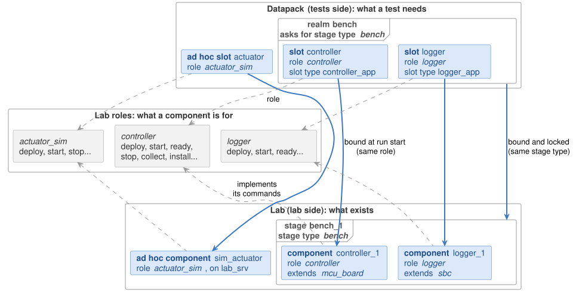
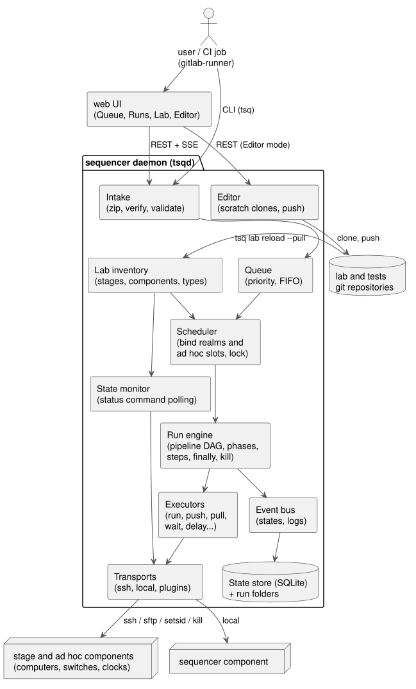
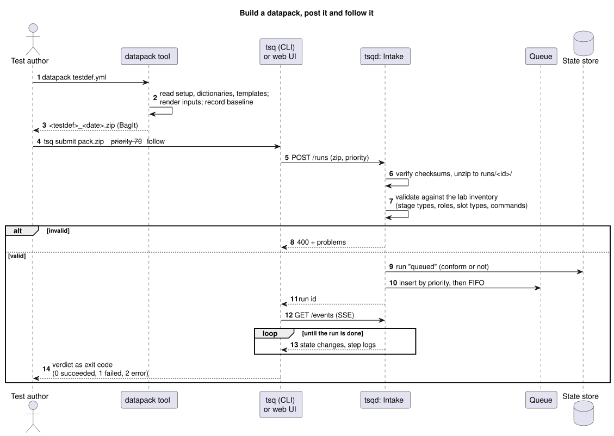
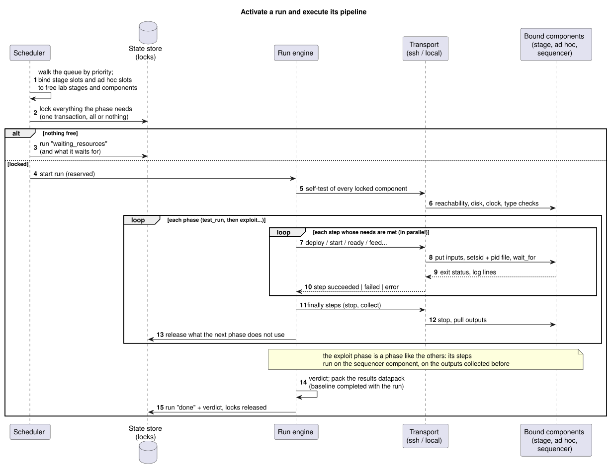
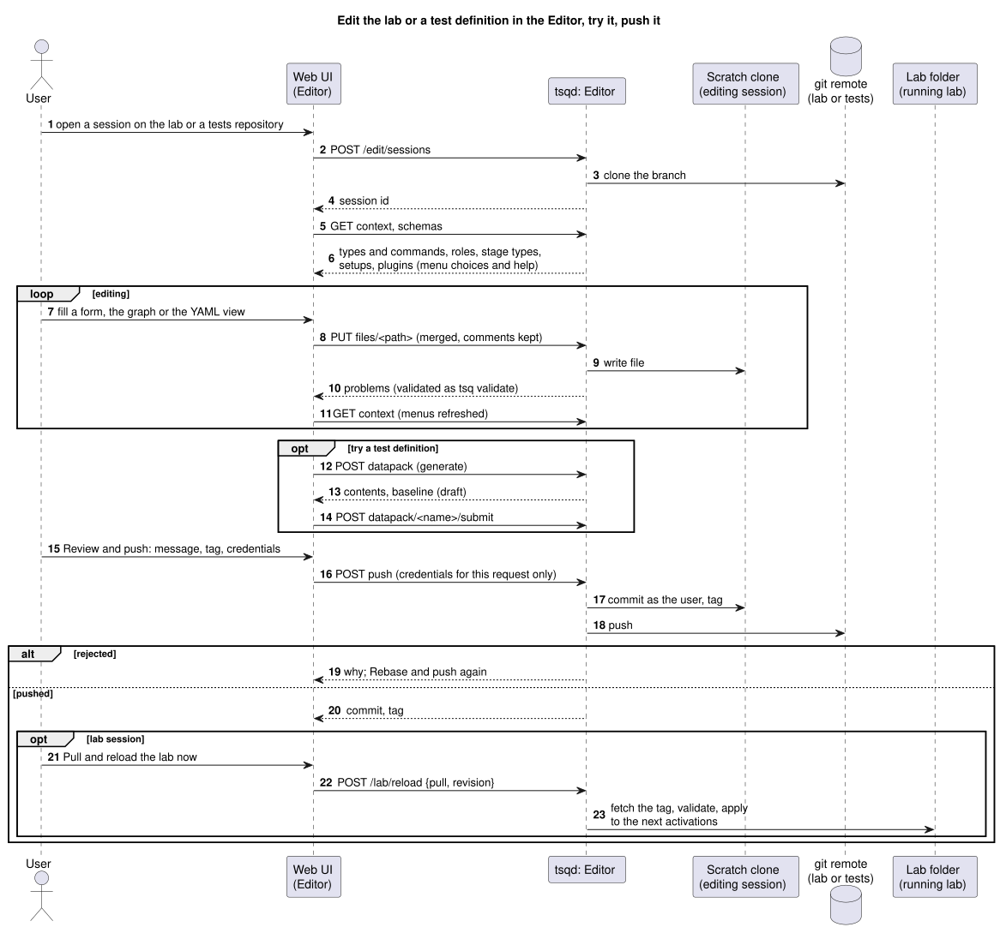
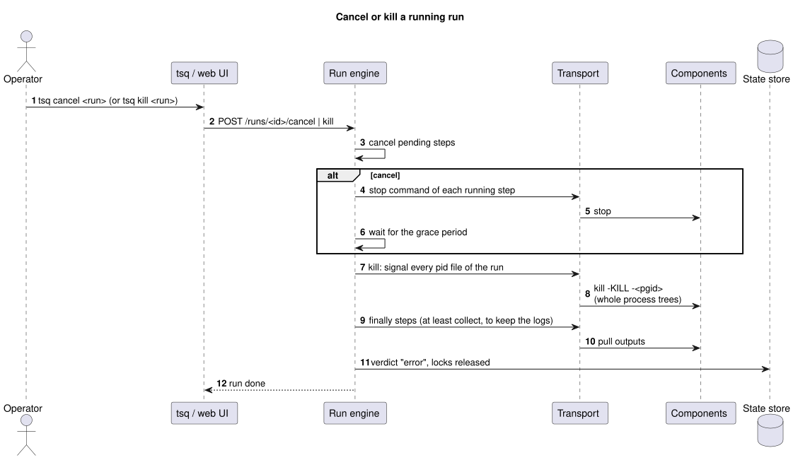
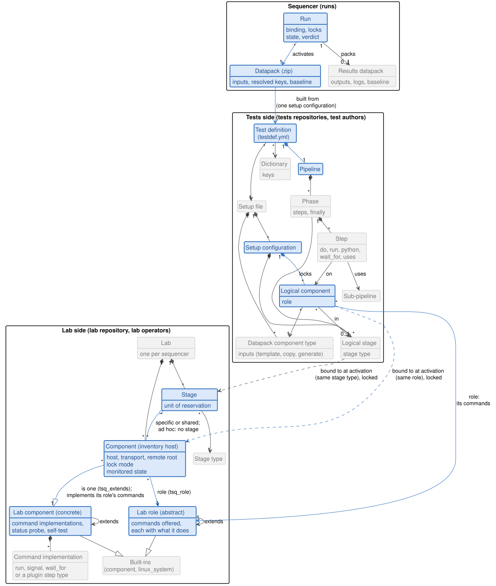

# sequencer: architecture overview

The sequencer runs real tests on a lab made of components (computers, switches, clocks...), grouped in **stages**. It takes a **datapack**, the zip built by the `datapack` tool, and queues it by priority. The datapack asks for **slots** (by role) grouped in **stage slots** (by stage type): when a stage and components matching them are free, the sequencer binds and locks them, then runs the datapack's **pipeline**:
1. deploy the slot inputs on the lab components bound to the slots;
2. start the components, in parallel or waiting for each other;
3. feed the system;
4. stop the components and collect their outputs;
5. analyse the results.

Several datapacks run at the same time when they use different stages.

One sequencer manages one lab: the whole set of components and the stages they belong to, however complex. Another lab, for example on another site, gets its own sequencer instance.

Status: implemented: `tsqd`, the REST API, the `tsq` command line, the datapack refinements, the GitLab executor scripts, and the web UI with its Editor mode (sections 13.1 and 13.2). [Implementation status](#18-implementation-status) lists where the code differs from this document and what is left. The tools that were considered, and why the design reuses their ideas and libraries rather than one of them as a whole, are in [benchmark.md](benchmark.md).

A sample configuration, a toy train on a one-stage lab with a simulated environment, is in [examples/toytrain](../../../examples/toytrain/README.md).

**Keys.** [Section 8.5](#85-keys-overview) lists the template keys available at generation, in pipeline steps and in lab commands.

**Where to start.** [Section 2](#2-user-manual) is the user manual: the key concepts, then what to do for each use case. The data model is in [section 4.3](#43-data-model).

Contents:
1. [Functional requirements](#1-functional-requirements)
2. [User manual](#2-user-manual)
3. [Principles](#3-principles)
4. [Overview](#4-overview)
5. [Datapack generation refinements](#5-datapack-generation-refinements)
6. [Lab inventory: stages and components](#6-lab-inventory-stages-and-components)
7. [Lab roles, lab components and state monitoring](#7-lab-roles-lab-components-and-state-monitoring)
8. [Datapack side: resources needed and pipeline](#8-datapack-side-resources-needed-and-pipeline)
9. [Queue, scheduling and locking](#9-queue-scheduling-and-locking)
10. [Running a datapack](#10-running-a-datapack)
11. [Abort and kill](#11-abort-and-kill)
12. [Extension points](#12-extension-points)
13. [Interfaces: CLI, REST API, UI, GitLab runner](#13-interfaces-cli-rest-api-ui-gitlab-runner)
14. [Building blocks and dependencies](#14-building-blocks-and-dependencies)
15. [Package layout](#15-package-layout)
16. [Implementation plan](#16-implementation-plan)
17. [Open points](#17-open-points)
18. [Implementation status](#18-implementation-status)

Annexes:
- A. [Cheat sheet](#annex-a-cheat-sheet)

## 1. Functional requirements

What the product shall do, gathered from the specifications discussed so far. The last column points to the section of this document that answers each requirement.

### 1.1 Main use cases

Who does what with the sequencer. [Section 2.2](#22-use-cases-step-by-step) says how to do each one.

| Id | Use case | Who | Requirements |
|---|---|---|---|
| UC-1 | **Describe the lab**: its stages, components, roles and lab components, in a git repository | lab operator | SQ-5, SQ-6, SQ-9, SQ-15, SQ-25 |
| UC-2 | **Monitor and maintain the lab**: states, self-test, maintenance and hold, commands by hand, reload | lab operator | SQ-10, SQ-11, SQ-23, SQ-26 |
| UC-3 | **Define a test**: the slots and stage slots it needs, their inputs, and the pipeline that runs it | test author | DG-1, DG-2, DG-3, SQ-12 to SQ-16, SQ-28, SQ-32 |
| UC-4 | **Build and check a datapack**: generate it, verify it, check its baseline and validate it against the lab | test author | DG-4, DG-5 |
| UC-5 | **Run a test and follow it**: post a datapack with a priority, see it queued, bound and running, live | test author, CI job | SQ-1 to SQ-4, SQ-7, SQ-8, SQ-11, SQ-24 |
| UC-6 | **Stop a run**: cancel or kill it, keeping cleanup and collection, then post it again | test author, lab operator | SQ-17 |
| UC-7 | **Get the results**: the collected outputs, logs, verdict and conformity, as a results datapack | test author, CI job | SQ-27, DG-5 |
| UC-8 | **Change the lab or the tests in the Editor**: edit in forms, try, push in one's name | lab operator, test author | SQ-29 |
| UC-9 | **Run tests from CI**, as a GitLab runner | CI job | SQ-20 |
| UC-10 | **Try the platform on a dev host**, every component emulated | anyone | SQ-31 |

### 1.2 Datapack generation

The sequencer reuses the testsuit `datapack` tool (YAML dictionaries, Jinja2 templates, self-sufficient BagIt zip), with these refinements:

| Id | Requirement | Section |
|---|---|---|
| DG-1 | The definition of each slot (its input files) comes from the YAML setup files the datapack tool already reads. These files can be extended to describe the test run (pipeline, stage slots and slots needed) and still be usable for a plain datapack. | 5, 8 |
| DG-2 | Generating a slot's inputs can involve processing specific to that slot, beyond rendering templates and copying files. | 5.1 |
| DG-3 | A slot can need other slots' inputs to generate its own. | 5.2 |
| DG-4 | A datapack is self-sufficient: it can be run from its zip contents only (inputs, resolved keys, test definition with its pipeline). | 10 |
| DG-5 | A datapack carries a **baseline**: where each of its contents comes from (git path, commit and tag of the original inputs, the processing tools and their versions, and, for results, the sequencer and the lab), so that the identity of the produced data can be controlled and checked against an expected baseline. A non-conform datapack is accepted but flagged as such, up to its results. | 5.3, 10 |

### 1.3 Queue and resources

| Id | Requirement | Section |
|---|---|---|
| SQ-1 | Accept and queue a datapack containing everything about the test to execute: slot inputs and the commands pipeline. | 10 |
| SQ-2 | Each datapack in the queue has a priority. Higher priorities are activated first, FIFO within a priority, and the priority of a queued datapack can be changed. | 9 |
| SQ-3 | When the resources a datapack needs are available, dequeue it and activate it on them. | 9 |
| SQ-4 | Several datapacks can run at the same time on different stages, for example two datapacks on two stages of the same type. | 9 |
| SQ-5 | The lab is made of components. A component belongs to one or more stages, or is ad hoc (outside any stage). A component in several stages is shared by them; one in a single stage is specific to it. An ad hoc component is for example a server running the exploitation tools, shared by all datapacks when it is not the sequencer host itself. | 6 |
| SQ-6 | The definition of a stage includes the list of its components and possible overrides of their commands, for example a specific configuration deployment. | 6, 7.4 |
| SQ-7 | When a datapack is activated, the resources it actually needs are reserved (locked). The granularity is the stage for components that belong to a stage, and the component itself for ad hoc components. | 9 |
| SQ-8 | A single datapack can lock several stages and ad hoc components. | 8.1, 9 |
| SQ-9 | Components can be of any type (computer, switch, clock...): mainly Linux based, no Windows. | 7, 12 |
| SQ-10 | The state of each component is monitored (for example idle, configured, running, broken), and broken components are not used. | 7.5 |
| SQ-23 | A stage or a component can be declared temporarily disabled, for example for maintenance: no new datapack is activated on it until it is enabled again. | 7.5, 9, 13 |
| SQ-11 | Visibility of the queued datapacks (with their priority and what they wait for), and of the state of stages and components. | 9, 13 |
| SQ-25 | The folder holding the lab inventory is configurable. The sequencer expects it to be a git clone, and warns when it is not under git or not on a clean tag. | 4.1, 6.1 |
| SQ-26 | Before each datapack, a platform self-test checks that every component involved can be reached and used properly. | 7.6, 10 |

### 1.4 Pipeline execution

| Id | Requirement | Section |
|---|---|---|
| SQ-12 | Run a commands pipeline that deploys configuration data, runs startup commands, feeds the system and retrieves the results into the outputs of the datapack. | 8.3, 10 |
| SQ-13 | Commands can run in parallel or wait for each other (rendez-vous points), depending on their configuration. They can be grouped in named phases to make the pipeline clearer. | 8.3 |
| SQ-14 | Readiness of a component is either checked objectively (port, log, file, command) or approximated with a plain delay. | 8.3 |
| SQ-15 | Default commands are given by a base component, for example "Linux system": scp to a standard target folder, with SSH keys configured so that no password is asked. A lab role lists the commands a component offers, and can extend another role; a lab component implements them, and can extend another component and override some of its commands. Each component instance has a role and is a component. | 7 |
| SQ-16 | The sequencer itself is a component like the others. The exploit phase (exploit_runner/mexploit analysis of the retrieved data) is a phase of the pipeline like any other, with the outputs of earlier phases becoming its inputs. | 2, 8.3 |
| SQ-17 | A test run can be forced to stop, killing the remote processes (`kill -9` or similar), while the cleanup and result retrieval still run. | 11 |
| SQ-27 | The data retrieved from the components after a run is added to the datapack contents. It can be large raw data, such as pcap files. | 10.1 |
| SQ-28 | A pipeline can be built as a sequence of sub-pipelines, to keep complex pipelines manageable. | 8.4 |
| SQ-32 | A pipeline step, or a command of a lab component, can be a Python script, run on a component or on the sequencer host, with the run's keys available to it. Its result is judged like a shell command's, and an uncaught exception is an `error`. | 8.3 |
| SQ-24 | Each run ends with a verdict: `succeeded`; `failed` when a command did not give its expected result, typically an unexpected return status; or `error` when a command crashed or could not complete (signal, timeout, unreachable component). | 8.3, 10 |

### 1.5 Interfaces and integration

| Id | Requirement | Section |
|---|---|---|
| SQ-18 | The product works from the command line, without any UI. | 13 |
| SQ-19 | An optional UI can be added on top of the kernel later. It covers posting a datapack; managing and monitoring components, queued datapacks and running datapacks; and accessing the contents of a datapack before, during and after its run. | 13.1 |
| SQ-29 | The UI has an optional **Editor** mode: edit the lab inventory, with helpers (for example the available roles and components when creating a component); create a new datapack definition and generate a datapack from it; create and update pipelines. Applying a modification asks the user for git credentials to push it; the sequencer then reloads this latest configuration on demand only. | 13.2 |
| SQ-30 | One overall YAML file defines the main configuration settings: storage folders (datapacks, runs, results), lab inventory folder, server, queue, self-test and monitoring defaults. | 4.1 |
| SQ-31 | A live example platform runs on a dev host, with every component emulated on the local host: the same test definitions, no hardware, no root access, no SSH. | 6.2 |
| SQ-20 | The product can act as a GitLab runner, for a future CI integration. | 13 |
| SQ-21 | Simple and modular, built on well-known open-source languages and libraries. | 3, 14 |
| SQ-22 | A single-team lab is enough for a first version: no access control in the kernel. | 13 |

## 2. User manual

What to do with the sequencer, in short; the sections after give the details. The commands are those of the [cheat sheet](#annex-a-cheat-sheet), and the web UI (section 13.1) does the same from its pages.

### 2.1 Key concepts



Two sides meet when a run starts:
- **The lab** (lab repository, lab operators) is what exists. A **component** is one element of it: a computer, a switch, a simulator on a server. Components are grouped in **stages**, each of a **stage type** (`bench`): a stage is locked as a whole. A component in no stage is **ad hoc**, locked on its own.
- **Lab roles** say what a component is for, as the **commands** it offers (`deploy`, `start`, `ready`, `stop`, `collect`, `install`...). Every component has one role, and implements its commands through the **lab component** it extends: the kind of hardware or software it is (`mcu_board`, `sbc`, `linux_system`).
- **The datapack** (tests repositories, test authors) is what a test needs. A **slot** is one thing it needs, by role ("the controller"); its **slot type** says which input files the slot gets. A **stage slot** is the same for a whole lab stage: it asks for a stage type, and the slots in it are bound in that one stage. A slot in no stage slot is an **ad hoc slot**.
- **A run** binds each stage slot to a free stage of its type and each slot to the component of its role there (an ad hoc slot to an ad hoc component of its role), locks them, then runs the **pipeline**: phases of steps, each step running a command of its slot's role on the component bound to it.

A test never names a host: the same datapack runs on any stage of the right type, real or emulated. [Vocabulary](#23-vocabulary) defines every term; [section 4.3](#43-data-model) shows how they relate.

### 2.2 Use cases, step by step

**UC-1 Describe the lab** (lab operator; sections 6 and 7):
1. In the lab repository, write the inventory: each stage with its stage type and its hosts, and the ad hoc hosts. Give each host its role and the lab component it extends.
2. Reuse or write the lab roles (`lab/roles/`) and lab components (`lab/components/`): a lab component implements every command of the roles it supports.
3. Check with `tsq lab status`, or in the Editor's lab session, whose problems list shows what is missing. Push, then `tsq lab reload --pull`.

**UC-2 Monitor and maintain the lab** (lab operator; sections 7.5 to 7.7):
- Follow the states with `tsq components` or the **Lab** page, and self-test with `tsq selftest [<stage>]`.
- Take a stage or component out of scheduling with `tsq maintenance <id> --note "..."` (back with `tsq resume <id>`), or keep it for yourself with `tsq hold <id>` (back with `tsq release <id>`).
- In maintenance, run its commands by hand with **Commands…** on the Lab page.

**UC-3 Define a test** (test author; sections 5 and 8):
1. In a setup file, write the slot types with their input files (templates, copies, generators), and a setup configuration with its stage slots and slots, each slot with its role and slot type.
2. In a test definition, give the setup file and configuration, the dictionaries, and the pipeline: phases that lock stage slots and ad hoc slots, steps that run a command on a slot, linked by `needs`, with `finally` steps that always run.
3. In the Editor (workspace session), **Add from the lab** creates the slots for every role of a stage type, the pipeline graph proposes each slot's commands, and the template preview shows a rendered input.

**UC-4 Build and check a datapack** (test author; sections 5 and 8):
- Build it with `datapack testdef.yml`, or **Generate…** on the **Datapacks** page.
- Check it with `datapack --verify <zip>` (checksums), `datapack --check-baseline baseline_expected.yml <zip>` (conformity) and `tsq validate <zip>` (binding and every command, against the lab).

**UC-5 Run a test and follow it** (test author; sections 9 and 10):
- Post it with `tsq submit <zip> --priority 70 --follow`, or from the **Queue** page.
- See it waiting with `tsq queue` (change its priority with `tsq priority <run> 90`), then running with `tsq show <run>` and `tsq logs <run>`, or on the **Runs** page with its pipeline graph and live logs.

**UC-6 Stop a run** (section 11): `tsq cancel <run>` stops the commands, then kills them; `tsq kill <run>` kills at once. Either way the `finally` steps still run and collect the outputs. `tsq repost <run>` puts an ended run back in the queue.

**UC-7 Get the results** (section 10.1): `tsq files <run>` browses the run folder (`data/<slot>/output/`, logs), and `tsq files <run> --results --get` downloads the results datapack. The verdict is `succeeded`, `failed` or `error`, and a results zip ending in `_NONCONFORM` did not match its expected baseline.

**UC-8 Change the lab or the tests in the Editor** (section 13.2): open a session on the lab or a tests repository, edit in the forms (each with its help and problems), **Generate a datapack** to try the change, then **Review and push…** to commit it in your name.

**UC-9 Run tests from CI** (section 13): a GitLab job builds the datapack and calls `tsq submit --wait --follow`, so the run log becomes the job trace and the verdict the job status.

**UC-10 Try the platform on a dev host** (section 6.2): an emulated lab runs every component as a local process; the [toy-train example](../../../examples/toytrain/README.md) has one. Follow the [cheat sheet](#annex-a-cheat-sheet) with `TSQ_CONFIG=tsq.dev.yml`.

### 2.3 Vocabulary

| Term | Meaning |
|---|---|
| **lab** | everything one sequencer manages: all the components and the stages they belong to. One sequencer instance per lab. |
| **component** | one managed element: a computer, a switch, a clock... Mainly Linux, never Windows. It has a host, a **role** (the commands it offers), a transport (how to reach it), commands (how to deploy, start, stop, collect, kill...), and a monitored **state** (idle, configured, running, broken...). |
| **stage** | a named set of components; the unit of reservation for the components it holds. A component can be **specific** to one stage or **shared** by several. |
| **ad hoc component** | a component that belongs to no stage, reserved on its own (for example a server running exploitation tools). |
| **lab inventory** | the file describing the stages and components of the lab, owned by the lab operators. |
| **datapack** | the self-sufficient zip built by `datapack`: slot inputs, every resolved key, and the test definition and setup (pipeline included). It says *what* to run; the lab inventory says *where*. |
| **slot** | what a datapack needs, by role ("the controller", "the simulated actuator"): bound to a lab component of that role at activation. A datapack has slots, the lab has components. |
| **stage slot** | what a datapack needs as a whole lab stage, by stage type ("a bench"): bound to a free lab stage of that type at activation, with the slots in it ("its controller, logger and acquisition units") bound to the components of that stage. A slot is filled by a component, a stage slot by a stage. A slot in no stage slot is an **ad hoc slot**, bound to an ad hoc component. |
| **run** | one activation of a datapack. |
| **phase / step** | the pipeline of a run: named phases (`test_run`, `exploit`...) made of steps (commands), run in parallel or waiting for each other (`needs`). |
| **sequencer component** | the sequencer host itself: an ad hoc component like the others (`transport: local`), never locked. |

**Lab side** (the lab repository, owned by the lab operators):

| Term | Meaning |
|---|---|
| **lab library** | the lab's roles and components, YAML files in the `tsq_library` folders of the inventory (`lab/roles/`, `lab/components/`). |
| **lab role** | abstract: what a component is for, as the list of commands it offers, each with what it does (section 7.1). A role `extends` another one and adds commands. Every component has one; datapacks bind their slots by role and run its commands. |
| **lab component** | concrete: how a kind of component implements commands, how its state is monitored, its self-test and transport (section 7.2). A component `extends` another one and overrides what differs. A component lists the roles it supports (`roles: [logger, acquisition]`) and must implement their commands; a base component lists none. An inventory host is itself a component: it extends one with `tsq_extends`, and can add its own `tsq_commands`. A host must implement every command its role lists. |
| **built-ins** | the roles and components `component` (no commands) and `linux_system` (deploy by SFTP, collect, kill process trees, status, self-test), which every role and component ends up extending (section 7.3). |
| **`extends`** | the parent of a role (whose commands it offers too) or of a component (whose implementations, status and self-test it inherits, overriding or adding some). The chain of parents is the **inheritance chain**. |
| **command** | a named action on a component: `deploy`, `start`, `ready`, `stop`, `collect`, `kill`, `status`, `version`, or any name a role adds (`install`, `feed`...). Its implementation is a shell `run` (possibly `detach`ed), a `signal`, a `wait_for` or a plugin step type. |
| **where a command comes from** | the role lists it; its implementation is resolved in this order, last wins: the host's component chain, the stage `tsq_commands`, the host's own `tsq_commands`, and an inline `run:` in a step (section 7.4). The Editor shows the source of each command. |
| **role** | the job of a component (`controller`, `logger`, `lab_network`...): the role of its lab component when that supports one, else picked with `tsq_role`. A lab role, so a role always offers the same commands, whatever the hardware. Slots are bound to lab components by role: a slot of a role takes a component of that role or of a role extending it. Several components of a stage can have the same role. |
| **stage type** | the kind of a stage (`bench`, `rack`...): a datapack's stage slot asks for a stage type, and any free stage of that type can be bound to it. |
| **lock mode** | `tsq_lock` of a component: `exclusive` (one run at a time, the default), `shared` (several runs at once) or `none` (never locked). Shared and unlocked components give each run its own input and output folders. |
| **remote root** | `tsq_remote_root`: the folder of a component under which its inputs, outputs and pid files go. |
| **transport** | how the sequencer reaches a component: `ssh`, `local`, or a plugin's (`tsq_transport`). |
| **state** and **state probe** | the monitored state of a component (`offline`, `idle`, `configured`, `running`, `broken`, `unknown`), computed by its component's `status` probe or a plugin's state probe. |
| **self-test** | the checks of each component a run uses, done before the run starts (section 7.6). |
| **maintenance / hold** | taking a component or stage out of scheduling, for repair (`tsq maintenance`) or for one's own use (`tsq hold`). |
| **reload** | `tsq lab reload [--pull <rev>]`: the running lab takes a new inventory and library, from the lab folder or a pushed revision. |

**Tests side** (the tests repositories, owned by the test authors):

| Term | Meaning |
|---|---|
| **test definition** (`testdef.yml`) | what one test is: its setup file and setup configuration, its dictionaries and its pipeline. `datapack testdef.yml` builds a datapack from it. |
| **setup file** and **setup configuration** | the setup describes the slots a test needs and their inputs; a setup has several named configurations (`sim_bench`, `emulated`...), each listing its stage slots and slots. |
| **slot type** | a type defined in a setup (`slot_types`): the inputs of a slot, by configuration. Its commands come from the slot's lab role. |
| **dictionary** | a YAML file of keys (`globals.yml`...) the templates and the pipeline can use. |
| **template** | an input file rendered with Jinja2 and the datapack keys (`{{ key }}`), one per slot. |
| **input methods** | how an input file is made: `template`, `copy`, or `generate` (a registered **generator**), optionally followed by `postprocess` **processors** (section 5.1). An **importer** fetches the datasets of a datasource (`importer: git`, a release store...). |
| **pipeline** | the phases and steps of a test definition; **`needs`** are the edges between steps, and each phase has **`finally`** steps that always run. |
| **step type** | what a step does: a command of its slot's role (`do`), `run`, `python` (a Python script), `wait_for`, `uses` (a sub-pipeline) or a plugin step type. A **ready check** is one condition of `wait_for` (port, log, file, command, or a plugin's). |
| **sub-pipeline** | a reusable group of steps with parameters, in the test definition or in a shared file, called with `uses` (section 8.4). |
| **baseline** | where each content of a datapack comes from (revisions, tags, tool versions) and, for results, the run; checked against an expected baseline, a mismatch makes the datapack **non-conform**. |
| **verdict** | the outcome of a run: `succeeded`, `failed` or `error`. |
| **results datapack** | the run folder packed as a datapack, with the collected outputs, logs and completed baseline (section 10.1). |
| **plugin** | a Python package registered through `testsuit.plugins`: it can add transports, step types, ready checks, state probes, importers, generators and processors (section 12). |

**Web UI and Editor:**

| Term | Meaning |
|---|---|
| **Editor mode** | the part of the web UI that edits the lab and tests repositories (`server.editor`, section 13.2). |
| **editing session** | a scratch git clone of one repository, on one branch, where the Editor writes (or, **in place**, the folder itself): a **lab session** edits the inventory, roles and components, a **workspace session** (one of `server.workspaces`) edits setups, test definitions, sub-pipelines, dictionaries and templates. |
| **context** | what the Editor's menus and help are built from: the types with their commands, roles, stage types, setups, test definitions and installed plugins, read again after each save. A lab session uses its own files; a workspace session uses the running lab. |
| **palette** | in the pipeline graph, what a step can do on each slot: its commands, with where each comes from, plus the generic and plugin step types. |
| **flattened view** | the whole pipeline with sub-pipelines expanded and every command resolved for a setup configuration, as the run will see it. |
| **draft datapack** | a datapack generated from uncommitted files of a session: the queue accepts it, its report says so. |
| **push** | committing a session's changes in the user's name, optionally tagged, and pushing them with credentials used for that request only. |

## 3. Principles

1. **Kernel first, headless.** Everything is available from a CLI and a REST API; a UI is only another API client.
2. **One YAML family, one template language.** The datapack test definition and setup (already on YAML and Jinja2) gain optional sections; a datapack without them is still a plain datapack. The lab inventory uses the standard Ansible YAML inventory format.
3. **Declarative pipeline, imperative escape hatches.** Pipelines, roles and components are YAML. Any command can be overridden by a derived component, per stage, per host, or inline. New transports, step types, state probes and generators come through the existing `testsuit.plugins` entry points.
4. **Safe by construction.** Locks are taken all at once and released by the kernel only. Every phase has a `finally` that always runs. Every remote process is started so that it can be killed with its whole process tree.
5. **Few, boring dependencies**, each replaceable.

## 4. Overview



One process (`tsqd`) runs an asyncio loop. There is no broker and no worker fleet: steps and state probes are mostly remote calls, so the work is I/O bound and one loop drives dozens of components. A dev mode (`tsq run --local`) runs one datapack in the foreground without a daemon.

### 4.1 Main configuration file

One YAML file, `tsq.yml`, holds the main settings of a sequencer instance. It is read from `--config`, else `$TSQ_CONFIG`, else `/etc/testsuit/tsq.yml`. Relative paths are relative to `storage.root` for the `storage` settings, and to the configuration file for the others (`lab.folder`, `server.workspaces`). Every setting has a default, so a minimal file only gives the lab folder.

```yaml
# tsq.yml
lab:
  folder: /srv/tsq/lab                 # git clone of the lab repository (section 6.1)
  inventory: lab.yml          # inventory file in that folder
  require_tag: true                    # warn unless the clone is on a clean tag
storage:
  root: /srv/tsq
  incoming: incoming                   # datapacks posted, waiting in the queue
  runs: runs                           # run folders, while running and until cleaned
  results: results                     # results datapacks (section 10.1)
  database: tsq.sqlite
  min_free_space: 20GB                 # a run is not activated below this
  max_run_output: 50GB                 # a run's collected outputs above this end it in error
  large_files: {threshold: 200MB, mode: zip}   # or 'external' (section 10.1)
  retention: {runs: 30d, results: forever}
server:
  listen: 0.0.0.0:8640
  ui: true
  editor: false                        # Editor mode of the UI (section 13.2)
  workspaces: [/srv/tsq/tests]         # git clones the Editor creates datapack definitions in
  title: Test sequencer                # the UI's title, in its top bar and browser tab
  logo: logo.png                       # optional image before the title: a file (relative to tsq.yml) or an http(s) URL
queue: {default_priority: 50, priority_aging: off}
selftest: {before_each_run: true, when_idle: true, timeout: 60s, max_attempts: 3}   # section 7.6
monitor: {interval: 30s}
plugins: [my_lab]                    # in addition to the installed entry points
```

`tsq config` prints the settings in use, with where each one comes from (file or default).

### 4.2 Main interactions

How the parts of section 4 work together in the main use cases of section 1.1.

**Build a datapack, post it and follow it** (UC-4, UC-5; sections 9 and 10):



**Activate a run and execute its pipeline** (UC-5; sections 9, 10 and 7.6):



**Edit the lab or a test definition in the Editor, try it and push it** (UC-8; section 13.2):



**Cancel or kill a run** (UC-6; section 11):



The figures of this document are PlantUML sources in [docs/diagrams](../../../docs/diagrams/), rendered to SVG with `sh docs/diagrams/render.sh path/to/plantuml.jar`.

### 4.3 Data model

The lab side describes what the lab is made of; the tests side describes what a test needs and does; a run binds the second to the first when it activates a datapack. The essentials are in blue: a run activates a datapack built from a test definition, whose setup configuration lists slots, each bound by role to a lab component (a stage slot groups slots bound in one lab stage); the lab role lists the commands, the lab component implements them. The technical details are in grey ([Vocabulary](#23-vocabulary) defines each term):



## 5. Datapack generation refinements

The `datapack` tool (`testsuit.datatools.datapack`, YAML dictionaries + Jinja2 templates + BagIt zip) stays the way to prepare a datapack. Two refinements cover the generation needs.

### 5.1 Slot-specific processing to generate inputs

Today an input is `method: template` (Jinja2) or `method: copy`, optionally followed by `postprocess` processors. A third method, **`generate`**, runs a registered **generator** that produces the target from the source and the keys. Examples: compile the controller's speed profile into the table its microcontroller reads, compute a calibration table, build a network configuration from a topology file.

```yaml
slot_types:
  controller_app:
    configurations:
      standard:
        inputs:
          - source: templates/profile.yml
            target: profile.bin
            method: generate
            generator: profile-compiler   # registered by a plugin
            options: {step: "{{ profile.step }}"}
```

A generator is a Python callable registered like processors (`testsuit.datatools.datapack.generators.register_generator(name, fn)`), called as `fn(source, target, keys, options, slot)`. When the name is not registered, it is run as a script relative to the setup folder, with the source, the target and a JSON file of the resolved keys. The keys a generator reads are recorded in `datapack.yml` like those of templates.

### 5.2 Slots needing other slots' inputs

A slot can declare `needs: [other_slot, ...]`. Slots are then generated in dependency order (topological sort, cycles reported), and a dependent slot sees the inputs already generated:
- `slots.<id>.input_dir`: path of the other slot's generated inputs, usable in templates and generators;
- `read_input('<id>/<file>')`, a Jinja2 function returning the text of a generated file (`| from_yaml` / `| from_json` filters to read structured data);
- generators receive the same paths.

```yaml
configurations:
  sim_bench:
    slots:
      controller:       {type: controller_app, configuration: standard}
      acquisition: {type: acquisition_app, configuration: standard}
      logger:
        type: logger_app
        configuration: standard
        needs: [controller, acquisition]   # records what they publish, read from their configurations
```

Both refinements keep the datapack self-sufficient: what a slot needed from another one is already in the zip.

### 5.3 Baseline

Each datapack carries a `baseline.yml`, the synthesis of where its contents come from. Since it is covered by the BagIt tag manifest, it cannot be changed without `datapack --verify` noticing.

The datapack tool already records part of it in `datapack.yml` (git commit, tag and cleanliness of the test definition and setup folders; source and version of each dataset). The baseline completes it and puts it in one place:

```yaml
# baseline.yml
datapack: {name: nominal_bench_setup_20261022T1012, format: 2, conform: true}
sources:                          # every original input, by git origin
  - {role: testdef, path: datapack/testdef/nominal/testdef.yml, repo: git@forge:lab/tests.git, commit: 3f2a9c1, tag: v1.4.0, clean: true}
  - {role: setup, path: datapack/setup/bench_setup.yml, repo: git@forge:lab/tests.git, commit: 3f2a9c1, tag: v1.4.0, clean: true}
  - {role: dictionary, path: datapack/setup/globals.yml, repo: git@forge:lab/tests.git, commit: 3f2a9c1, tag: v1.4.0, clean: true}
  - {role: dataset, id: app_sw, importer: release-store, source: releases/app, version: v0.3.0}
tools:                            # what processed them
  - {name: testsuit, version: 3.2.0}
  - {name: lab-testenv, kind: plugin, version: 0.1.0}        # generators, processors, importers
  - {name: jinja2, version: 3.1.6}
files:                            # each generated file and what produced it
  data/controller/input/controller.yml: {from: [datapack/setup/templates/controller.yml], method: template, sha256: 9e1f...}
  data/controller/input/profile.bin: {from: [datapack/setup/templates/profile.yml], method: generate, generator: profile-compiler, sha256: 44ab...}
```

When the sequencer produces the results zip (section 10), it extends the baseline with a `run` part:
- the sequencer version and its plugins;
- the git commit and tag of the lab inventory and of its library (roles and components);
- the concrete stages and components the run was bound to;
- the software version of each component, when its role offers a `version` command (for example `app-install --version` on a controller, the firmware id of an actuator controller), read before the first phase.

**Conformity.** A baseline is **conform** when every source is a clean, tagged git state and every dataset version was confirmed. This is what `--nocheck` relaxes today, and a `--nocheck` datapack is marked `conform: false`. An **expected baseline** is a YAML file with the same structure, holding only what must match: tags, versions, tool versions, component versions, possibly with patterns (`tag: "v1.4.*"`). It is checked:
- by `datapack --check-baseline expected.yml pack.zip`, and when building with `datapack ... --baseline expected.yml`;
- by the sequencer at submission (`tsq submit --baseline expected.yml`, or `pipeline.baseline` in the test definition);
- before the first phase for the `run` part (component versions).

A non-conform datapack is **accepted but flagged**, never rejected. This covers both kinds: a datapack that is not conform in itself (`conform: false`), and one that does not match its expected baseline. The run proceeds normally, and its verdict is unchanged, but:
- the run is flagged `non-conform` in the queue, in `tsq runs` and `tsq show`, in the REST API and the UI, and in the GitLab job trace;
- the differences are listed, one line per mismatch, kept in the run record and written to the results baseline (`run.conform: false` with the mismatches);
- the results zip is named with a `_NONCONFORM` suffix, like the `_DRAFT` suffix the datapack tool already gives to `--nocheck` datapacks.

So the identity of produced data can always be checked afterwards, and non-conform results can't be mistaken for baseline results.

## 6. Lab inventory: stages and components

The lab inventory follows the [Ansible YAML inventory](https://docs.ansible.com/ansible/latest/inventory_guide/intro_inventory.html) format. It is a well-known standard, and the same file can be used with `ansible` for ad hoc operations, but Ansible is not a dependency: the sequencer reads it with its own loader. The format maps naturally onto the lab:
- a **group** per stage, its hosts being the stage's components;
- a host listed in **several stage groups** is a shared component;
- a host in **no group** (directly under `all`) is an **ad hoc component**;
- **group variables** are stage-level settings and command overrides.

Sequencer settings use the `tsq_` prefix, the convention for tool-specific inventory variables.

The examples of this document use a sample lab: two identical stages of type `bench` (a controller, a logger and an acquisition unit each, joined by a shared switch) and a lab server running two simulations as ad hoc components. Two stages show concurrent runs and a shared component; a runnable lab built the same way is the [toy-train example](../../../examples/toytrain/README.md):

```yaml
# lab/lab.yml (Ansible YAML inventory format)
all:
  vars:
    ansible_user: tsq                              # standard names, reused by the sequencer
    ansible_ssh_private_key_file: ~/.ssh/id_lab   # key-based auth only, no password prompt
    tsq_remote_root: /opt/testrun                  # default target: <root>/<component>/{input,output}
    tsq_library: [roles/, components/]             # lab roles and components, relative to this file (section 7)

  hosts:                                           # ad hoc components: in no stage
    lab_srv:        {ansible_host: localhost, tsq_transport: local, tsq_role: sequencer, tsq_lock: none}
    sim_actuator:   {ansible_host: localhost, tsq_transport: local, tsq_extends: actuator_sim}
    sim_sensor:     {ansible_host: localhost, tsq_transport: local, tsq_extends: sensor_sim}

  children:
    bench_1:                                       # a stage
      vars:
        tsq_stage_type: bench                      # what datapacks ask for
      hosts:
        controller_1: {ansible_host: 10.42.1.10, tsq_extends: mcu_board}
        logger_1:     {ansible_host: 10.42.1.11, tsq_extends: sbc, tsq_role: logger}
        acq_1:        {ansible_host: 10.42.1.12, tsq_extends: sbc, tsq_role: acquisition}
        switch_1:     {ansible_host: 10.42.1.2, tsq_extends: plain_switch, tsq_role: switch}
        lab_switch:   {ansible_host: 10.42.0.2, tsq_extends: plain_switch, tsq_role: lab_network, tsq_lock: shared}
    bench_2:                                       # a second stage of the same type
      vars:
        tsq_stage_type: bench
        tsq_commands:                              # stage override: this bench's controller has no flashing helper
          install: {run: "flash-tool --input-dir {{ component.input_dir }}/app"}
      hosts:
        controller_2: {ansible_host: 10.42.2.10, tsq_extends: mcu_board}
        logger_2:     {ansible_host: 10.42.2.11, tsq_extends: sbc, tsq_role: logger}
        acq_2:        {ansible_host: 10.42.2.12, tsq_extends: sbc, tsq_role: acquisition}
        switch_2:     {ansible_host: 10.42.2.2, tsq_extends: plain_switch, tsq_role: switch}
        lab_switch: {}                             # shared with bench_1: joins both benches to lab_srv
```

- A stage is defined by its components (the hosts of its group) and its overrides (`tsq_commands` and the other variables of its group).
- Variables follow Ansible precedence: host over stage group over `all`.
- `tsq_description` says what an item is, shown in the editor and on the Lab page. It is set at three levels, each separate and not inherited: in `all.vars` it describes the lab, on a stage group the stage, on a host the component. `tsq_label` is the component's short name.
- `tsq_tags` lists tags, on a host or a stage group: a datapack slot or stage slot asking for `tags` only binds to a component or stage having them all (section 8.1). The id of a component or stage is always one of its tags. Tags on another group apply to its hosts.
- `tsq_extends` is the lab component each host is (section 7.2): a component of the library, or another host. It gives the implementations of the commands, the status probe and the self-test. Default `linux_system`. A host can add its own `tsq_commands`, `tsq_status`, `tsq_selftest` and `tsq_collect`, which win over the component's. The lab does not load when a host does not implement a command its role lists; a command a host implements that its role does not list is a warning.
- Each host has a role, a lab role (section 7.1): the commands it offers. It is the role of its component when that supports one (`controller_1` is a controller, as `mcu_board` supports only that role); when it supports several, `tsq_role` picks one (`sbc`: logger or acquisition); when it lists none (`lab_srv`, a plain `linux_system`), `tsq_role` gives any role. Several components of a stage can have the same role (two loggers): each slot of that role gets its own.
- `tsq_shell` is the shell the commands of a component run under, on the component (`bash`, `/bin/bash`, `"bash -l"` to read the login profile). By default, steps and commands run under `/bin/sh` (dash on Debian and Ubuntu), whatever the user's login shell, while short checks (probes, self-tests) run under the login shell; with `tsq_shell`, both use it. A POSIX shell is expected: the sequencer's own helpers (pid files, kill) run under it too.
- `tsq_type` and `tsq_types` are gone: `tsq_role` and `tsq_extends`, and `tsq_library`, replace them.
- `tsq_lock` is the lock mode of a component:
  - `exclusive` (default): one datapack at a time;
  - `shared`: several datapacks at once, for passive components such as a network switch nobody configures. In the example, `bench_1` and `bench_2` can run two datapacks at the same time although they share `lab_switch`;
  - `none`: never locked, for the sequencer component.
  - A `shared` or `none` component gives each run its own folders, `<remote_root>/.tsq/<run>/<component>/{input,output}`, so that two runs deploying to it at once do not clobber each other's files; an `exclusive` one uses `<remote_root>/<component>/{input,output}`.
- Components are taken out of scheduling by state, not by editing the file: a `broken` state (section 7.5), or `tsq maintenance <component>`.

### 6.1 Where the inventory lives

The inventory and its library live in the folder `lab.folder` of the main configuration (section 4.1), which the sequencer expects to be a **git clone** of the lab repository. The lab then has a history, and every run can name the exact lab definition it ran on.

- At startup and on `tsq lab reload`, the sequencer reads the git state of the folder: commit, tag on that commit, and whether the work tree is clean.
- A **warning** is shown when the folder is not a git work tree, has local changes, or is not on a tag (with `require_tag: true`, the default). It appears at startup, in `tsq lab status`, as a banner in the UI, and in the record of every run activated meanwhile.
- The warning does not stop the sequencer. The git state is written to the `run` part of each results baseline (section 5.3), so a run on an untagged lab is flagged non-conform when its expected baseline names a lab tag.
- The inventory is loaded at startup and reloaded only on demand, never on its own: `tsq lab reload` reloads the folder as it is, and `tsq lab reload --pull [<tag | commit>]` first fetches the lab repository and checks out that revision (the latest commit of the branch by default). The Editor's Reload button does the same (section 13.2). A reload is validated first and refused if invalid, leaving the folder on its previous revision. Running datapacks keep the components they are bound to; the new inventory applies to the next activations.

### 6.2 Emulated lab on a dev host

A lab can have an **emulated** twin that runs on one Linux computer, for writing and debugging tests and pipelines, and for demonstrations. It is the same mechanism as a real lab, with three files instead of hardware:
- **an inventory** with the same stage types and roles, where every component uses the `local` transport, each with its own `remote_root`;
- **lab components implementing the same roles** as the lab's, where each one runs its application as a local process (started by the sequencer, stopped by a signal) and replaces the hardware it touches by a stand-in, through host variables (`tsq_start_args`). The datapacks bind by role, so they bind unchanged;
- **a main configuration** (`tsq.dev.yml`) pointing to that inventory, with local storage and the server listening on `127.0.0.1` only.

On the datapack side, only what the platform changes (addresses, for example) goes in a dictionary of its own, chosen by the setup configuration: `datapack <testdef> --setup-config emulated` builds the datapack of the same test definition for the emulated platform. Then `tsq run <datapack.zip> --local --config tsq.dev.yml` runs it in the foreground, or `tsqd --config tsq.dev.yml` serves the queue and the UI locally.

In the sample lab, an emulated platform would make:
- every computer a process with an address of its own on the loopback interface (`127.0.0.10` and up), which carries multicast traffic with no setup;
- the controller's microcontroller a host stub;
- the acquisition unit's GPIO inputs UDP datagrams from the sensor simulation;
- the switch disappear.

The [toy-train example](../../../examples/toytrain/README.md#emulated-mode-on-a-dev-host) has such an emulated platform.

A run on an emulated lab is flagged non-conform against the campaign's expected baseline, whose lab tag it does not match (section 5.3).

## 7. Lab roles, lab components and state monitoring

The lab library has two levels, each a hierarchy where one `extends` another:
- a **lab role** is abstract: what a component is for, as the commands it offers, each with what it does. A datapack binds a slot by role, so the commands it can use are known from the role alone, whatever the hardware;
- a **lab component** is concrete: how a kind of component implements commands, how its state is monitored, its self-test and transport. A component lists the roles it supports, and the library checks it implements all their commands. Each inventory host is a component too: it extends a component (`tsq_extends`), has its role (or picks one of its roles with `tsq_role`) and must implement every command of that role.

Like classes in object-oriented programming:

| Lab | Object-oriented parallel | Example |
|---|---|---|
| lab role | abstract class (an interface): the commands offered, each with what it does, and no implementation | `controller`: `install`, `start`, `stop`, `ready`, `version` |
| lab component | concrete class: implements the commands of the roles it supports, adds a status probe and a self-test, and inherits the rest from its parent (`extends`) | `mcu_board`, extending `linux_system`, supports `controller` |
| inventory component (host) | instance of a concrete class (`tsq_extends`), with its own variables: address, remote root, label... It can still override a command (`tsq_commands`), like a per-instance method | `controller_1: {tsq_extends: mcu_board, ansible_host: 10.0.0.21}` |
| datapack slot | a variable typed by the abstract class: it uses only the commands of the role | `controller: {type: controller_app, stage_slot: bench, role: controller}` in the setup |

A datapack references roles only. When it is activated, the sequencer picks, for each slot, a free inventory component of the required role (in a free stage of the type its stage slot asks for), and runs the role's commands with that instance's implementation: the same datapack runs on any lab whose instances implement its roles, real hardware or emulation (section 6.2).

Both are YAML, in the `tsq_library` folders of the inventory: a library file holds `roles:`, `components:` or both. Plugins can also register them in Python (`register_role`, `register_component`).

### 7.1 Lab roles

```yaml
# lab/roles/bench.yml
roles:
  bench_app:                               # abstract: the hosts take one of the roles below
    extends: linux_system                  # deploy, collect, kill
    description: An application on a bench computer
    commands:                              # names, each with what it does: no implementation
      start:   Starts the application. State afterwards running.
      stop:    Stops the application cleanly. State afterwards idle.
      ready:   Waits until the application logs READY.
      version: Prints the version of the application, recorded in the results baseline.
  controller:
    extends: bench_app
    commands:
      install: Flashes the microcontroller part from the deployed inputs.
  logger:      {extends: bench_app}
  switch:      {extends: component}        # only monitored: no command
  lab_network: {extends: component}
  actuator:                                # the actuator controller, real or simulated
    extends: component
    commands: {stop: Stops the actuator., kill: Stops the actuator at once.}
  sequencer:   {extends: linux_system}     # the sequencer host: where the exploitation runs
```

**Expected inputs.** A role can list the inputs a component of that role expects in its input folder, under `inputs`. Each one has:
- `name`: its path there, which is the `target` of the datapack input. A folder ends with `/`.
- `type`: `file` (the default) or `folder`.
- `optional`: whether the component can work without it.
- `description`: what it is and how to make it, in Markdown, as long as needed.

A role extending another one adds to its inputs, or redefines one by name. In a setup, a slot type names the role of its slots (`role: controller`). Its configurations then start with the inputs that role requires: the Editor adds them when the role is picked, when a configuration is added, and when a type is created for a role. The Editor shows each input's description next to the datapack input that provides it. It warns about a required input a configuration lacks, and about a slot whose role differs from its type's.

```yaml
roles:
  controller:
    extends: bench_app
    inputs:
      - {name: app/, type: folder, description: "The release folder of the role: `make release`."}
      - {name: controller.yml, description: "Start from `templates/controller.yml` of the setup."}
      - {name: notes.txt, optional: true}
```

### 7.2 Lab components

```yaml
# lab/components/bench.yml
components:
  sbc:
    extends: linux_system
    roles: [logger, acquisition]           # the roles it supports: it implements their commands
    commands:
      start:   {run: "sudo systemctl start app-{{ component.role }}", timeout: 30s}
      stop:    {run: "sudo systemctl stop app-{{ component.role }}", timeout: 30s}
      ready:   {wait_for: {log: {file: "{{ component.output_dir }}/app.log", regex: "READY"}, timeout: 30s}}
      version: {run: "app-{{ component.role }} --version"}
    status:
      probe: {run: "systemctl is-active app-{{ component.role }}"}
      states:                              # first match wins, on the probe output
        running: {regex: "^active"}
        broken:  {regex: "^failed"}
        idle:    {regex: "^inactive"}

  mcu_board:
    extends: linux_system                  # Debian on the MPU, plus a microcontroller to flash
    roles: [controller]                    # its hosts are controllers, without tsq_role
    commands:
      install: {run: "sudo /usr/local/bin/app-install --input {{ component.input_dir }}", timeout: 2m}
      start:   {run: "sudo systemctl start app-{{ component.role }}"}
      stop:    {run: "sudo systemctl stop app-{{ component.role }}"}
      # ready and version too: a controller host must implement every command of its role

  plain_switch:
    extends: component                     # an unmanaged switch: only monitored
    roles: [switch, lab_network]
    transport: local                       # probed from the sequencer host
    status:
      probe: {run: "ping -c 1 -W 1 {{ component.host }}"}
      states: {running: {exit: 0}, offline: {exit: nonzero}}

  actuator_controller:                     # the real one, on the real bench
    extends: component                     # not a Linux system: its own protocol
    roles: [actuator]
    transport: vendor-udp                  # plugin (section 12)
    commands:
      stop:  {run: "stop"}
      kill:  {run: "stop"}
    status:
      probe: {run: "speed"}
      states: {running: {regex: "^[1-9]"}, idle: {regex: "^0"}}

  actuator_sim:                            # a simulation, from the inputs a datapack deploys
    extends: sim_base                      # the base of the simulations, listing no role
    roles: [actuator_sim]
    commands:
      start: {run: "sim actuator --config {{ component.input_dir }}/actuator_sim.yml", detach: true}
```

`roles` is inherited by the components extending one, unless they list their own; a base component (`sim_base`) lists none. An inventory host extends one of them (`controller_1: {tsq_extends: mcu_board}`, a controller), or another host. The same roles can be implemented by other components in another lab: an emulated lab can implement them with local processes, as the toy-train example does in `lab/components_emulated/`, and the datapacks bind to it unchanged (section 6.2).

### 7.3 Built-ins

| Name | Role: commands offered | Component: implementation and state |
|---|---|---|
| `component` | none: the abstract root, for components that are not Linux systems (a switch or a clock driven through their own API) | `unknown` state unless a `status` probe is defined |
| `linux_system` (extends `component`) | `deploy`, `collect`, `kill` | `deploy`: push `data/<slot>/input/` to `<remote_root>/<slot>/input/` (scp/sftp over SSH, key-based); `collect`: pull `<remote_root>/<slot>/output/` back to `data/<slot>/output/`; `kill`: kill the process trees started by the run (section 11). State: `offline` when SSH fails, `running` while a unit started by the sequencer is active, `idle` otherwise |

### 7.4 Where commands come from

The commands of a component come from the lab only: its role lists them (with its parent roles: `controller` → `bench_app` → `linux_system`), and the implementation used is resolved in this order, last wins:
1. the chain of the host's component, from the base down (`component` → `linux_system` → `mcu_board`);
2. the stage `tsq_commands` (lab inventory);
3. the host's own `tsq_commands` (lab inventory);
4. an inline `run:` in a pipeline step.

A datapack does not redefine commands: what a test runs that the role does not offer is a `run:` step of its pipeline (the exploitation in section 8.3). A stage with a special way of deploying overrides the generic command for every datapack.

A `run` command can run **through another component** too, with `via` (a role of the component's stage, or another host), like a status probe (section 7.5): for a component in a sub-network behind the stage server, `start: {run: "obc-ctl --host {{ component.host }} start", detach: true, via: stage_server}`. Its processes and pid files are on that component, so `signal`, `kill`, an abort and the end of the run stop them there. The component's own host is then not needed to bind it (with an absolute `tsq_remote_root`, the default).

The commands, status probes and self-test checks of a component can use the **other components of the lab** in their keys, with their id, host, role, label and variables (as seen in their stage):
- `{{ stage.roles.<role>.host }}`: the component of that role in the component's stage (the first one when the stage has several), for a lab component that works in any stage (`{{ stage.roles.stage_server.vars.psu_address }}`);
- `{{ stage.components.<host>.host }}`, `{{ stage.id }}`, `{{ stage.type }}`, `{{ stage.vars }}`: the stage itself and its components by inventory name;
- `{{ lab.components.<host>.vars.ansible_host }}`: any host of the inventory; `{{ lab.stages.<stage>.components }}`: the hosts of a stage.

A component's own variables (`{{ component.vars }}`) include those of its stage group in its status probe and self-test too.

### 7.5 State monitoring

Each component has a monitored **state**:

| State | Meaning |
|---|---|
| `offline` | unreachable |
| `idle` | reachable, nothing running |
| `configured` | inputs deployed, not started |
| `running` | started |
| `broken` | reachable but faulty |
| `unknown` | no probe can tell |

- The **state monitor** runs each component's `status` probe periodically: every `status.interval` (default 30 s), more often for the components of active runs. Results go to the event bus and the state store.
- The sequencer also knows the **expected** state: `configured` after `deploy`, `running` after `start`, `idle` after `stop`. When the probed state differs from the expected one (expected `running`, probed `idle` or `broken`), an event is raised. The step fails or only warns, as set by `on_state_mismatch: fail | warn` (default `warn`).
- A state can be waited for in a pipeline: `wait_for: {state: running}`.
- A probe can hold **several checks**, `run: [<command>, <command>...]`: each runs whatever the others gave, and is OK when it exits with 0. The rules match their outputs, one after the other, and an `exit` rule the first non-zero exit status (0 when all are OK). The Lab page shows each check with its answer, OK or FAILED.
- A component the sequencer cannot reach itself, in a sub-network behind the stage server, is probed **through another component**: `status.via` names a role of its stage (or another host). The probe's command runs there, with that component's transport, and gets `{{ component.host }}` (the component probed) and `{{ via.host }}`. The `run` checks of its self-test run there too, and the checks of a Linux system (login, remote root, disk, clock) are skipped. `via` takes a `run` or plugin probe. A component that is off between runs is mapped to `idle`, not `offline`, so that its stage stays available:

  ```yaml
  obc:
    extends: component
    roles: [obc]
    status:
      via: stage_server                     # the stage's component of role stage_server
      probe: {run: "psu-ctl get ch1; ping -c 1 -W 1 {{ component.host }} >/dev/null && echo UP || echo DOWN"}
      states: {running: {regex: "ON[\\s\\S]*UP"}, broken: {regex: "ON[\\s\\S]*DOWN"}, idle: {regex: "OFF"}}
  ```
- A `broken` or `offline` component is not used for new runs. A stage is unavailable while one of its components is. A component that recovers becomes available again, unless an operator put it in `maintenance`.

This is distinct from the **lock state** (free or held by a run), shown next to it.

### 7.6 Platform self-test

Before each datapack, once its resources are locked and before anything is deployed, the sequencer runs a **self-test** of every component bound to the run, in parallel. It checks that each one can be reached and used, so that a run does not fail halfway because of the platform.

A lab component gives its checks in `selftest` (a host in `tsq_selftest`), and a derived component adds to its parent's checks:

| Component | Checks |
|---|---|
| `component` | its `status` probe answers, and the state is not `broken` or `offline` |
| `linux_system` | the above, plus: SSH login with the lab key, `<remote_root>/<component>/` writable, free disk space above `min_free_space`, clock offset with the sequencer host under `max_clock_offset` (default 1 s) |
| lab components | anything specific, for example `app-install --check` on a controller, or a ping of the switch |

```yaml
components:
  mcu_board:
    extends: linux_system
    selftest:
      - {id: mcu_link, run: "sudo /usr/local/bin/app-install --check", timeout: 20s}
```

- **When it passes**, the run goes on, and the results are kept in the run record and in the results datapack (`selftest.yml`).
- **When a check fails**, nothing is deployed. The failing component is marked `offline` or `broken`, the run's locks are released, and the run goes back to the head of the queue for its priority: it can then bind another stage, or wait. After `selftest.max_attempts` failed attempts (default 3), the run ends with the verdict `error`.
- `tsq selftest [<stage | component>]` runs the same checks on demand, for example after maintenance, without any datapack.
- A component whose self-test failed **stays** `broken` (or `offline`) even when its probe says it is healthy, until a self-test passes. Its detail tells which check failed.
- With `selftest.when_idle` (default `true`), a self-test also runs when a component becomes `idle` (it was offline, broken, running...), except for a component an active run holds. A component kept broken by its self-test is tested again when its probe says it is idle, at most once a minute, and comes back once a test passes.

### 7.7 Commands run by hand, in maintenance

A component in maintenance (or in a stage in maintenance) can have its commands run by hand, to check or fix it. Use the **Commands…** button on the Lab page, or `GET /components/<id>/commands` and `POST /components/<id>/commands/<command>`. It is refused while a run holds the component.

- **`run` commands** run with the keys of the lab, as a status probe does: `component.*` (with `component.vars`), `via`, `stage.*` and `lab.*`. There are no datapack keys (`params`, `slot`, `slots`), so a command that needs one does not render. A command with `via` runs through that component.
- **A detached command** (`detach: true`, such as `start`) keeps running. Its pid file goes under `<root>/.tsq/manual/<component>/`.
- **`signal` commands and the built-in `kill`** stop the processes started by hand there.
- **Other commands** (`deploy`, `collect`, `wait_for`, `python`) need a run, and are not offered.
- **Each command run by hand** is recorded as a `manual_command` event, which is kept for audit.

## 8. Datapack side: resources needed and pipeline

### 8.1 Resources a datapack needs

The setup configuration (datapack side) lists the **slots** the test needs, each with a **role**, and the **stage slots** that group slots which must be bound in one lab stage, each asking for a stage type. A slot in no stage slot is an **ad hoc slot**. At activation:
- each stage slot is bound to a free lab stage of its type;
- each slot of a stage slot is bound to its own lab component of that stage, whose role is the slot's role or extends it;
- each ad hoc slot is bound to a free ad hoc lab component whose role is the slot's role or extends it;
- `tags` on a stage slot or a slot keep only the lab stages or components having all of them (`tsq_tags`, the id being one): they route a test to given hardware, or to a subset of it.

**How slots get their components.** A stage can have several components of a role. Within a stage, the slots with the fewest possible components are assigned first, so the only component of a specific role (one extending the slot's role) or with a required tag goes to the slot that needs it; the slots with several options are assigned next. Each slot takes, in inventory order, a component of its very role before one of a role extending it. When a choice leaves a later slot without a component, the sequencer takes another one. A stage is bound only when each of its slots gets a distinct component; `tsq check` and the run's resources page say what is missing. To pin a slot to a given component, give it that component's id as a tag; for components tied to given wiring, a derived role (`fast_logger: {extends: logger}`) is clearer than tags.

In the Editor, a stage slot lists one row per slot of each role, with **+ another <role>** while its lab stages have more components for that role. The **Tags** of a slot propose the tags of the lab components it could be bound to (its role or one extending it, in the stages its stage slot can take); those of a stage slot propose the tags of the lab stages of its type. The inventory form sets `tsq_tags` on a component or a stage.

A datapack has slots and stage slots; the lab has components and stages. The former datapack names (`component_types`, a configuration's `components`, `stages` and `realms`, a slot's `stage` and `realm`, a step's `component`, a phase's `components`, `stages` and `realms`, `for_each: components`) are refused, with the current one.

```yaml
# setup file (datapack)
configurations:
  sim_bench:
    stage_slots:
      bench: {type: bench}               # bound to the lab stage bench_1 or bench_2, whichever is free
    slots:
      controller:  {type: controller_app, configuration: standard, stage_slot: bench, role: controller}
      logger:      {type: logger_app, configuration: standard, stage_slot: bench, role: logger}
      acquisition: {type: acquisition_app, configuration: standard, stage_slot: bench, role: acquisition}
      actuator:    {type: actuator_sim, configuration: standard, role: actuator_sim}   # ad hoc
      sensor:      {type: sensor_sim, configuration: standard, role: sensor_sim}       # ad hoc
      analysis:    {type: exploit, configuration: standard, role: sequencer}           # ad hoc: lab_srv
  calibrated:
    stage_slots:
      bench: {type: bench, tags: [rev_b]}  # only a bench stage tagged rev_b
    slots:
      logger:      {type: logger_app, configuration: standard, stage_slot: bench, role: logger, tags: [calibrated]}
      logger_2:    {type: logger_app, configuration: standard, stage_slot: bench, role: logger}  # another logger
```

A datapack can therefore lock several lab stages (one per stage slot) and ad hoc components. Here the analysis runs on the sequencer host (`role: sequencer`); a separate exploitation server would be an ad hoc component with its own role.

### 8.2 Slot types

Slot types (in the setup file) declare the inputs of the slots, by configuration. They say nothing about commands: a slot gets those of its lab role, implemented by the lab component it is bound to (section 7).

```yaml
slot_types:
  controller_app:
    configurations:
      standard:
        inputs:
          - {source: "{{ app_sw.path }}/controller/", target: app/, method: copy}
          - {source: templates/controller.yml, target: controller.yml}
  actuator_sim:
    configurations: {standard: {inputs: [{source: templates/actuator_sim.yml, target: actuator_sim.yml}]}}
  exploit:
    configurations:
      standard:
        inputs:
          - {source: templates/exploit.yml, target: exploit.yml}
          - {source: "{{ testdef.path }}/criteria/", target: scenario/, method: copy}
```

`extends` and `commands` in a slot type, or `commands` in a slot, are refused with what to write instead. A command only this test needs is a `run:` step of the pipeline, on the slot (section 8.3).

### 8.3 Pipeline (test definition)

The pipeline lives in the test definition (already kept as is in the datapack). Its syntax is close to GitLab CI so that it reads familiar. Every phase follows the same rules, the exploit phase included: it lists the stage slots and ad hoc slots it needs, can take earlier phases' outputs as inputs, and runs steps.

```yaml
pipeline:
  timeout: 15m
  phases:
    - id: test_run
      stage_slots: [bench]                      # stage_slot locked for this phase (with its lab stage)
      slots: [actuator, sensor]            # ad hoc slots locked for this phase
      steps:
        - {id: deploy, for_each: slots, do: deploy}                    # fan-out, in parallel
        - {id: flash_controller, slot: controller, do: install, needs: [deploy]}
        - {id: start_sims, for_each: [actuator, sensor], do: start, needs: [deploy]}
        - {id: sims_ready, for_each: [actuator, sensor], do: ready, needs: [start_sims]}
        - {id: start_logger, slot: logger, do: start, needs: [deploy]}
        - {id: logger_ready, slot: logger, do: ready, needs: [start_logger]}
        - {id: start_acq, slot: acquisition, do: start, needs: [deploy, sims_ready]}
        - {id: acq_ready, slot: acquisition, do: ready, needs: [start_acq]}
        - id: start_controller                                                   # rendez-vous
          slot: controller
          do: start
          needs: [flash_controller, sims_ready, logger_ready, acq_ready]
        - {id: controller_running, wait_for: {state: running, slot: controller, timeout: 20s}, needs: [start_controller]}
        - {id: run, delay: "{{ scenario.duration_s }}s", needs: [controller_running]}   # no objective end
        - {id: stop_controller, slot: controller, do: stop, needs: [run]}
        - {id: stop_all, for_each: [acquisition, logger, actuator, sensor], do: stop, needs: [stop_controller]}
      finally:                                                              # always runs, even on abort
        - {id: kill_leftovers, for_each: slots, do: kill, if: "not succeeded('stop_all')"}
        - {id: collect, for_each: slots, do: collect}

    - id: exploit
      needs: [test_run]
      slots: [analysis]                    # an ad hoc slot (bound to the sequencer host)
      inputs:                              # outputs of earlier phases become inputs
        - {from: "test_run:logger/output/logger.csv", to: "analysis/input/data/"}
        - {from: "test_run:actuator/output/actuator.log", to: "analysis/input/data/"}
      steps:
        - {id: deploy, slot: analysis, do: deploy}
        - id: analyse                      # a command of this test only: a run step on the slot
          slot: analysis
          needs: [deploy]
          run: "exploit_runner {{ slot.input_dir }}/exploit.yml"
          timeout: 15m
          expect: {exit: [0]}              # exit 0: criteria ok, else failed
      finally:
        - {id: collect, slot: analysis, do: collect}
```

Phase fields: `id`, `needs`, `stage_slots` (stage slots, each with the lab stage bound to it), `slots` (ad hoc slots), `inputs`, `steps`, `finally`, `timeout`.

Step fields:
- target: `slot`, or `for_each` (a list of slots, `slots` for all the slots of the phase, or a role); the step runs on the lab component bound to each slot;
- action, one of: `do` (a named command), `run` (inline shell), `python` (a Python script, below), `push` / `pull`, `delay`, `wait_for`, or a plugin step type;
- options: `needs`, `if`, `expect`, `timeout`, `retries`, `detach`, `continue_on_error`, `env`.

`expect` gives the expected result of a step: `exit` (exit codes, default `[0]`), and optionally `stdout` or `stderr` (regex). A step that ran but did not give the expected result is `failed`. A step that could not run or did not finish normally is `error`: a crash (killed by a signal), a timeout, a transport failure, an unreachable or broken component, or an internal sequencer error.

**Python steps** (SQ-32). `python` runs a Python script where `run` would run a shell command: on the lab component bound to the step's slot, or on the sequencer host for a step without one. It is also allowed wherever a lab component implements a command, so a component's `start` or `ready` can be a script.

```yaml
- id: check_peak                           # inline code, on the sequencer host
  needs: [run]
  python:
    code: |
      import csv, sys
      rows = list(csv.DictReader(open(keys["run"]["dir"] + "/data/logger/output/logger.csv")))
      top = max(float(r["value"]) for r in rows)
      print(f"peak value {top}")
      sys.exit(0 if top <= keys["limits"]["max_value"] else 1)
- id: analyse                              # a script deployed with the slot's inputs
  slot: analysis
  needs: [deploy]
  python:
    script: "{{ slot.input_dir }}/analyse.py"
    args: ["{{ slot.input_dir }}/data", "{{ slot.output_dir }}"]
    interpreter: "{{ component.vars.venv }}/bin/python"   # default: the lab component's tsq_python, else python3
```

- **Source**: `script` is a path on the target, usually an input of the slot (`data/<slot>/input/`, so it is part of the datapack and of its baseline); `code` is inline and sent with the command. One of the two.
- **Keys**: before the script runs, the sequencer writes every key the step's templates can use (the datapack's `context.yml` and the run-time keys) to a JSON file, under `<remote_root>/.tsq/<run>/<lab component>/python/<step>/` with the wrapper below, and gives its path in `TSQ_KEYS`. The script finds them already loaded as `keys`, or reads them with `json.load(open(os.environ["TSQ_KEYS"]))`. `args`, `env`, `script` and `interpreter` are Jinja2 templates like any command; inline `code` is not (it reads `keys`).
- **Result**: the same as for `run`: the exit status and output are checked against `expect`, and `timeout`, `retries`, `detach` and `continue_on_error` apply. A small wrapper runs the script and turns an uncaught exception into exit status 70 with its traceback on stderr, which makes the step `error`, not `failed`: a crashed check says nothing about the system under test.
- **Where**: on a `linux_system` component, through its transport like any command, in the same process group and pid file, so `kill` stops it, with `interpreter`, else the component's `tsq_python` variable, else `python3`. The target needs nothing but a Python 3 interpreter, not testsuit. Without a slot, it runs on the sequencer host in the run folder (relative paths such as `data/logger/output/logger.csv` work), with the daemon's own interpreter by default, so testsuit and its libraries are there; still as a separate process, never inside `tsqd`, so a script cannot block the daemon or crash it.
- **Help in the Editor**: the step palette offers **Python script** next to **shell command**, the step and command forms switch between a script file (with its arguments) and inline code edited as Python, and `tsq validate` lists each python step with its script.

The toy-train example has one: `check_data` in the exploit phase of its test definitions runs `setup/scripts/check_data.py`, deployed with the analysis inputs, to check that the test run collected complete data before `exploit_runner` judges it.

`wait_for` covers ready checks done from outside: `state` (section 7.5), `tcp`, `http` (status or regex), `file`, `log` (regex), `cmd` (exit 0), each with `timeout` and `interval`.

`inputs` copies files inside the run folder, from `<phase>:<slot or *>/output/...` to `<slot>/input/...`, before the phase starts. Nothing is copied from host to host.

Validation (Pydantic) rejects cycles, unknown ids and steps on slots outside the phase, at submission time (`tsq validate` before that).

Templates in commands are rendered with Jinja2, the same environment as the datapack tool, in two layers:
- the datapack's frozen keys from `context.yml`;
- run-time keys: `run.*`, `phase.id`, `slot.*`, `slots.<id>.*`, `component.*` (the lab component bound to the slot), `stage_slots.<id>.stage`, `stage.*`, `lab.*`, `remote_root`: section 8.5 lists them all.

### 8.4 Sub-pipelines

A pipeline can be built from **sub-pipelines**: named groups of steps, declared once under `pipeline.subpipelines` and used as a single step with `uses`. The pipeline of section 8.3 becomes:

```yaml
pipeline:
  subpipelines:
    bring_up:                              # deploy, start everything, controller last
      steps:
        - {id: deploy, for_each: slots, do: deploy}
        - {id: flash_controller, slot: controller, do: install, needs: [deploy]}
        - {id: start_sims, for_each: [actuator, sensor], do: start, needs: [deploy]}
        - {id: sims_ready, for_each: [actuator, sensor], do: ready, needs: [start_sims]}
        - {id: start_logger, slot: logger, do: start, needs: [deploy]}
        - {id: logger_ready, slot: logger, do: ready, needs: [start_logger]}
        - {id: start_acq, slot: acquisition, do: start, needs: [deploy, sims_ready]}
        - {id: acq_ready, slot: acquisition, do: ready, needs: [start_acq]}
        - {id: start_controller, slot: controller, do: start, needs: [flash_controller, sims_ready, logger_ready, acq_ready]}
        - {id: controller_running, wait_for: {state: running, slot: controller, timeout: 20s}, needs: [start_controller]}
    shut_down:                             # controller first, then the others given as a parameter
      params: {others: [acquisition, logger, actuator, sensor]}
      steps:
        - {id: stop_controller, slot: controller, do: stop}
        - {id: stop_others, for_each: "{{ params.others }}", do: stop, needs: [stop_controller]}

  phases:
    - id: test_run
      stage_slots: [bench]
      slots: [actuator, sensor]
      steps:
        - {id: up, uses: bring_up}
        - {id: run, delay: "{{ scenario.duration_s }}s", needs: [up]}
        - {id: down, uses: shut_down, needs: [run]}
      finally:
        - {id: kill_leftovers, for_each: slots, do: kill, if: "not succeeded('down')"}
        - {id: collect, for_each: slots, do: collect}
```

- A `uses` step stands for the whole group. Its `needs` apply to the group's first steps, and a step that needs it waits for all the group's steps. Its verdict is the worst of its steps' verdicts.
- Inside a group, steps keep their own `needs`, so a sub-pipeline has its own parallelism and rendez-vous points.
- Step ids are namespaced in logs, status and the UI (`up.start_logger`), so the same sub-pipeline can be used several times.
- `params` declares parameters with their defaults, given by `with:` on the `uses` step and read as `params.*` in the group.
- A sub-pipeline can use other sub-pipelines. Cycles and unknown names are rejected at validation, and `tsq validate` can print the pipeline flattened.
- Sub-pipelines shared by several test definitions can live in YAML files listed in `pipeline.include`, relative to the test definition. The datapack tool copies them into the datapack's `definition/` folder, so the datapack stays self-sufficient.

### 8.5 Keys overview

Every template (`{{ ... }}`) sees keys that depend on where it is rendered. Datapack names (`slot`, `stage_slot`) and lab names (`component`, `stage`) never mix: a key named after a datapack thing gives the datapack's view, a key named after a lab thing gives the lab's.

| Key | Generation (datapack tool) | Pipeline steps, and the commands they run | Lab only (status probe, self-test, commands by hand) |
|---|---|---|---|
| dictionary keys, `<dataset>.{path, version}` | yes | yes (frozen in `context.yml`) | no |
| `testdef.*`, `setup.*`, `datapack.*` | yes | yes (frozen) | no |
| `slot.{id, name, type, configuration, input_dir}` | the slot being generated | | no |
| `slots.<id>.{id, input_dir}`, `read_input('<id>/<file>')` | the slots it `needs` | | no |
| `slot.{id, name, type, role, stage_slot, component, input_dir, output_dir, remote_root}` | | the step's slot; `slot.component` is the id of the lab component bound to it | no |
| `slots.<id>.*` | | the same keys, for any slot of the run (`slots.controller.component`) | no |
| `stage_slots.<id>.stage` | | the lab stage a stage slot is bound to | no |
| `component.{id, host, label, role, extends, stage, vars, input_dir, output_dir, remote_root, state}` | | the lab component bound to the step's slot: `id` is its inventory name, `stage` its lab stage, `slot` the slot it is bound to | the component itself |
| `remote_root` | | the lab component's remote root | the component's |
| `stage.{id, type, vars, components.<host>, roles.<role>}` | | the lab stage of the step's lab component | the component's lab stage |
| `lab.components.<host>`, `lab.stages.<stage>` | | yes | yes |
| `via.{id, host, vars}` | | | in a probe or command with `via`: the component it runs on |
| `run.{id, dir, priority}`, `phase.id` | | yes | no |
| `params.<name>` | | in a sub-pipeline: its parameters | no |
| `succeeded('<step>')`, `failed`, `errored`, `skipped`, `verdict` | | in `if:` | no |

`input_dir` and `output_dir` are the same in `slot` and `component`: `<remote_root>/<slot>/input` and `/output` on the lab component (under `<remote_root>/.tsq/<run>/` for a shared or unlocked component). A step with no slot (a `run` or `python` on the sequencer host) has no `slot`, `component` or `stage` key. The Editor completes these keys after `{{` in every field rendered with them, with this help.

An input template is rendered at generation, before any run binds its slots to the lab, so a run-time key there (`component.*`, `stage_slots.*`, `stage.*`, `lab.*`) is an error that says so, with the way out: `slot.*` in the template, or the value passed from a pipeline step (its `env` or command). The Editor's template preview shows the same message, and completes only the generation keys in a template.

## 9. Queue, scheduling and locking

**Priority.** Each run has a priority, an integer from 0 to 100 (default 50), given at submission (`tsq submit --priority 80`) and changeable while queued (`tsq priority <run> 90`). The queue is ordered by priority, then by submission time. Optional aging (`priority_aging: +1 per 30 min`, off by default) keeps low-priority runs from waiting forever.

**Scheduling.** Whenever resources are released, a run is queued, or a component recovers, the scheduler walks the queue in order. For each run it tries to bind the stage slots and ad hoc slots of its first phase to free lab stages and components (section 8.1). A resource is free when it is not `broken`, `offline` or in maintenance, and each of its components is free for its lock mode:
- an `exclusive` component is free when no other run holds it;
- a `shared` component is free unless another run holds it exclusively.

A lower-priority run may start while a higher-priority one waits, but only on resources the waiting run cannot use (backfilling), so priority is respected without leaving the lab idle. Among several free candidates, the stage used last by the same test definition is preferred, then the least used one.

**Concurrency.** Runs that bind to different stages and ad hoc components run at the same time. In the example inventory, a `bench` datapack runs on `bench_1` and holds the two simulations of `lab_srv`. A second one can only bind `bench_2` once simulations are free too: with a second pair (two more ad hoc components with the same roles), both run together, sharing `lab_switch`, while a third one waits for a stage.

**Locking.**
- The granularity is the **stage** for components that belong to a stage, and the **component** for ad hoc components.
- Everything a run needs for a phase is locked in **one database transaction**, all or nothing, so there are no partial holds and no deadlocks.
- A component shared by two stages of the same run is locked once. A component shared with a stage held by another run makes this run wait, unless the component is `shared`.
- Locks are recorded per run, stage and ad hoc component, with who holds them and since when.

**Per phase.** At the end of a phase, the resources the next phase doesn't use are released, and those it does use stay held. Optionally, a run can pre-reserve the resources of all its phases at activation (`reserve: all`), so it isn't stuck between phases.

**Visibility.**
- `tsq queue` shows each waiting run with its priority and what it waits for (no free `bench` stage: `bench_1` held by run A, `bench_2` broken).
- `tsq stages` and `tsq components` show stages and components with their monitored state, lock state and holder.

## 10. Running a datapack

1. **Submit**: `tsq submit pack.zip [--priority N]`, or a datapack posted through the REST API (UI, CI).
   - Intake verifies the BagIt checksums (`datapack --verify`) and unzips into `runs/<run_id>/`.
   - It reads the pipeline, commands, resources needed and `context.yml` from the zip only.
   - It validates them against the lab inventory: stage types, roles, slot types, commands.
   - The run state is `queued`.
2. **Activate**: binding and locking (section 9), a check that `storage.min_free_space` is available, then the platform self-test of every locked component (section 7.6). The run state goes `waiting_resources → reserved → selftest → running`.
3. **Phases**:
   - Before a phase, the kernel copies its `inputs` and binds and locks its resources if they aren't held yet.
   - The engine builds the step DAG and starts every step whose `needs` are met, as asyncio tasks, one command at a time per component unless `detach`.
   - Each step's output goes to `runs/<id>/logs/<phase>/<step>[<component>].log` and to the event bus.
4. **Finally**: the `finally` steps of each phase always run, with their own timeout. The phase's resources are released afterwards, unless the next phase uses them.
5. **Verdict**, one of three, computed from the steps (those with `continue_on_error` excepted):
   - `succeeded`: every step gave its expected result;
   - `failed`: at least one step ran but did not give its expected result, typically an unexpected exit status, and no step is in `error`;
   - `error`: at least one step crashed or could not complete (section 8.3), or the run was cancelled or killed. The test outcome is then unknown, not negative.

   The status of each phase and step is kept.
6. **Results**: the run folder becomes the results datapack (section 10.1), whose baseline gets the `run` part (section 5.3). The run record stays in the database as history.

State machines:
- run: `queued → waiting_resources → reserved → selftest → running → cleaning → done`, or `cancelled` while still queued; a done run carries its verdict, and an aborted run (`tsq cancel`, `tsq kill`) gets the verdict `error`;
- step: `pending → ready → running → succeeded | failed | error | skipped`, with the reason of an `error` kept (crash, timeout, killed, transport).

### 10.1 Results: retrieved data in the datapack

Everything retrieved from the components becomes part of the datapack contents. The **results datapack** is the run folder, packed with the same layout as the datapack it came from:
- `data/<slot>/input/`: the inputs, unchanged;
- `data/<slot>/output/`: everything `collect` retrieved, whatever its size or format (logs, CSV, binary records, pcap files...);
- `logs/`: the log of every step;
- `selftest.yml`, `run.yml` (states, verdict, step statuses) and the completed `baseline.yml`.

The BagIt manifests are recomputed over all of it, so `datapack --verify` checks the outputs too. It is written to `storage.results` as `<run>/<datapack>_results.zip`, with the `_NONCONFORM` suffix when flagged (section 5.3); the run folder keeps the same datapack submitted several times apart.

Large raw data, such as pcap captures of a long run, is handled without loading it in memory:
- **Transfer**: `collect` streams files over SFTP, computes their SHA-256 on the fly, and resumes an interrupted transfer. Each lab component can restrict what it collects (`collect: {include, exclude, max_size}`), for example to leave scratch files on the target.
- **Packing**: zip64, so files and archives over 4 GB work. Files over `storage.large_files.threshold`, and formats that are already compressed (`.gz`, `.zst`, `.pcapng.gz`...), are stored without compression, which keeps packing fast and lets the UI read them from the zip directly.
- **External mode**: with `large_files.mode: external`, files over the threshold stay next to the zip, in `<datapack>_results.data/`, and the zip lists them in BagIt's `fetch.txt` with their size and checksum. The bag stays complete and verifiable, without one huge archive to copy around.
- **Limits**: a run is not activated when less than `storage.min_free_space` is free, and collected outputs over `storage.max_run_output` end the run in `error`, after `finally`. Both are shown in the UI before they bite.

During the run, the outputs are already in the run folder as they are collected, and can be browsed from the CLI (`tsq files <run>`) and the UI (section 13.1).

## 11. Abort and kill

- **`tsq cancel <run>`**: a queued run leaves the queue. On a running one, pending steps are cancelled and running steps get their `stop` command; after a grace period, the kill below follows.
- **`tsq kill <run>`**: no grace. The `kill` command of every running step, then the `finally` steps (at least `collect`, to keep the logs), then the locks are released.
- **Remote processes** on `linux_system` components start in a process group of their own, recorded in a pid file:
  - `setsid -w sh -c ...` (ssh) or a new session (local), the group id written to `<remote_root>/.tsq/<run>/<component>/<step>.pid`;
  - `kill -KILL -<pgid>` for each pid file kills whole process trees, even when the ssh session is gone, and a group is alive while `ps` lists a member that is not a zombie;
  - it needs nothing on the target but a POSIX shell, `setsid` and `ps`; a component that prefers systemd units overrides `start` and `kill`.
- **Other lab components** override `kill`: stop the actuator controller through its own protocol, `virsh destroy` a VM, reload a switch configuration.
- **`tsq repost <run>`** (or Re-post in the run view of the UI): an ended run (done or cancelled) goes back to the queue under the same run id, with the same priority. Its outputs are removed (the run folder and the results zip) and the datapack is unpacked again from the zip that was posted, after the same check against the lab as a new post.
- **Daemon restart**: runs found `running` are marked `error`, then their `kill` and `finally` steps run, then their locks are released. `tsq release <stage | component>` is the audited manual escape hatch.

## 12. Extension points

Through `testsuit.plugins` (entry points or `TESTSUIT_PLUGINS`), next to the existing registrations:

| Registration | Purpose | Built in |
|---|---|---|
| `register_transport(name, cls)` | how to talk to a component: `run(cmd, env, timeout, detach)`, `put`, `get`, `signal`, `is_alive` | `ssh` (AsyncSSH), `local`, `http` |
| `register_role(name, definition)`, `register_component(name, definition)` | lab roles and components defined in Python rather than in the YAML library | `component`, `linux_system` |
| `register_state_probe(name, fn)` | new kinds of `status` probes | `run`, `http` |
| `register_step_type(name, cls)` | new step kinds | `run`, `push`, `pull`, `delay`, `wait_for` |
| `register_ready_check(name, fn)` | new `wait_for` kinds | `state`, `tcp`, `http`, `file`, `log`, `cmd` |
| `register_generator(name, fn)` | datapack `method: generate` (section 5.1) | none |

Components of any type are handled this way. A managed switch is driven through an SSH, REST or SNMP transport and its own component, the actuator controller through its UDP protocol, a board through a `labgrid` transport, and a component managed by playbooks through an `ansible` step type. A package such as `examples/toytrain` ships, in its `plugin.py`, its file formats, criteria and importers, and would add its transports, roles and components the same way.

## 13. Interfaces: CLI, REST API, UI, GitLab runner

**CLI** (`tsq`), working against a local or remote daemon:

```
tsq submit <datapack.zip> [--priority N] [--wait] [--follow]
tsq priority <run> <N>                                      # change the priority of a queued run
tsq validate <datapack.zip | testdef.yml> [--lab lab.yml]   # resources, pipeline, commands, fully expanded
tsq run <datapack.zip> --local                              # no daemon: dev mode, foreground
tsq queue                                                   # waiting runs, priorities, what they wait for
tsq runs [--state running] | tsq show <run> | tsq logs <run> [--step S] [-f]
tsq cancel <run> | tsq kill <run> | tsq repost <run>
tsq stages | tsq components                                 # monitored state, lock state, holder
tsq hold | release | maintenance | resume <stage | component>
tsq selftest [<stage | component>]                          # platform self-test on demand (section 7.6)
tsq files <run | datapack.zip> [<path>] [--get]             # browse or download a datapack's contents
tsq lab status | reload [--pull [<rev>]]                   # inventory git state; reload on demand (section 6.1)
tsq config                                                  # settings in use, and where each comes from
```

`--wait` returns the run verdict as exit code (0 succeeded, 1 failed, 2 error), and `--follow` streams the logs: what scripts and CI need.

**REST API** (FastAPI, OpenAPI generated):
- `POST /runs` (multipart zip, priority), `GET /runs`, `GET /runs/{id}`, `PATCH /runs/{id}` (priority), `POST /runs/{id}/cancel|kill|repost`, `GET /runs/{id}/logs/{step}`;
- `GET /stages`, `GET /components`, `POST /stages/{id}|/components/{id}/hold|release|maintenance|resume`;
- `GET /components/{id}/probe` (the last probe's report: what was tested, on which host and transport, each command and its answer, the rule that matched and why, plus the last self-test), `POST /components/{id}/probe` (probe now, and return the new report);
- `GET /runs/{id}/files/{path}` (list or download, with HTTP range requests for large files), the same for queued datapacks and results;
- `POST /selftest`, `GET /lab` (inventory, roles, git state), `POST /lab/reload`;
- `GET /events` (Server-Sent Events: run and component state changes, log lines);
- `GET /runs/{id}/pipeline` (phases and steps after sub-pipeline expansion, with their `needs`: the run graph of the UI);
- Editor mode only (section 13.2):
  - `GET /edit` (repositories, sessions, last pushes), `POST /edit/sessions` (scratch clone of a repository, or `local: true` to edit it in place), `GET|DELETE /edit/sessions/{id}`;
  - `GET /edit/sessions/{id}/files`, `GET|PUT|DELETE /edit/sessions/{id}/files/{path}` (a `PUT` of `data` merges it into the file, keeping its comments), `POST .../rename`;
  - helpers: `GET .../context` (lab roles and components, stage types, workspace contents), `GET .../schemas` (JSON Schemas with help and the lab's choices), `POST .../validate`, `.../flatten`, `.../palette`, `.../keys`, `.../preview`, `POST /edit/reachability`;
  - `POST .../synthesis` (a test definition's stage slots and slots, inputs, dictionaries and baseline datasets with the versions their importer lists), `POST .../baseline` (set a dataset's version where it is written);
  - `POST .../datapack` (generate), `GET .../datapack/{name}[/files/{path}]`, `POST .../datapack/{name}/submit`;
  - `GET .../diff`, `POST .../push` (credentials in the request body, never stored), `POST .../rebase`; then `POST /lab/reload` with a revision.

The kernel never depends on the UI below: it is a web front end on the REST API, served by `tsqd` when `server.ui` is set.

### 13.1 UI

| Use case | What the UI offers |
|---|---|
| Post a datapack | upload a zip, set its priority and an optional expected baseline; see at once whether it is valid, conform, and which stage types it waits for |
| Manage and monitor components | stages and components with their monitored state, lock state and holder, self-test results, history of state changes; hold, release, maintenance, resume and self-test buttons. Clicking a component's state opens its probe report: what was tested (probe kind, host, transport, each command), the system's answer and exit status, the state rules with the one that matched, why the state is what it is (a failed self-test keeping it broken, with the failed checks, their command and answer), and a *Probe again* button |
| Manage and monitor the queue | queued datapacks in order, with priority (editable), age and what each waits for; cancel |
| Monitor running datapacks | the pipeline as a graph of phases, sub-pipelines and steps, with live states and logs; cancel and kill, re-post an ended run |
| Access a datapack's contents | before the run (queued: inputs, definition, keys, baseline), during the run (inputs, outputs collected so far, logs) and after it (the results datapack): a file tree with viewers for text, YAML, CSV and logs, and downloads for the rest, large files included |

### 13.2 Editor mode

An optional mode of the same UI, enabled with `server.editor` (off by default, since it writes files). It edits the YAML files the CLI tools read, and adds nothing the files cannot express: whatever it does can also be done with a text editor and git.

**Where it is.** Two entry points replace a separate Editor tab:
- **Datapacks** (top-level tab) lists the test definitions of the `server.workspaces` repositories, through an in-place session on each. For the one selected it shows its baseline (each dataset, the version in use, the versions its importer lists, and the dictionary key or file that writes it, with a **Set** to change it there), its logical configuration (stage slots and slots, with their role), its template and input files per slot, and its dictionaries with their keys. **Generate…** runs the datapack tool on it; **Edit datapack definitions** opens the repository in the Editor. The versions come from the importer's optional `listVersions()`: tags then branches of the remote for `git` (`git ls-remote`), the releases of the store for the toy-train importer.
- **Edit lab config**, on the Lab tab, opens the lab repository in the Editor, in place.
Leaving a session, with its back link or **Close**, returns to the tab it belongs to: Lab for the lab repository, Datapacks for a tests repository. Leaving a lab session asks whether to reload the lab: from the folder as it is for an in-place session, from the latest pushed commit (`tsq lab reload --pull`) for a scratch clone.
The Editor home (`#/edit`, linked as **Editing sessions** on the Configuration tab) still lists every session and can open a scratch clone.

**Where it works.** An editing session works either in place, on the folder of the repository being edited (the lab repository, or one of `server.workspaces`), or in a scratch clone of it, on the branch it was opened on, so that a half-done change never reaches the running lab. On the Editor home, `in place (no clone)` is ticked by default; untick it for a scratch clone. `POST /edit/sessions` clones unless it is given `"local": true`.

**In place.** A session that edits the folder itself:
- The files are saved where the sequencer reads them. A lab change still applies only on **Reload**; a test definition is used the next time a datapack is generated.
- The folder need not be a git work tree. When it is, the session works on the checked-out branch, and review and push commit and push only the edited folder, in the user's name: other changes of that working copy are left alone. From a detached HEAD (a lab on a tag) nothing can be pushed.
- Rebase replays the working copy's own commits on the upstream branch; it never drops them.
- One in-place session per repository at a time; opening it again returns the same session. Closing it keeps the files.

**Lab inventory.**
- Forms for stages, ad hoc components and their variables, with a YAML view next to them.
- **Roles** and **Components** views of a library file: a role lists its commands with what each does, its parent's commands and the hosts that take it; a component shows each implementation with the component it comes from, its status probe and self-test, and the hosts extending it. Renaming one makes the inventories and the other library files of its folders follow.
- Helpers: when creating a host, the roles it can take (those of the stage first) and the components it can extend; its resolved commands, each with where it comes from, and the commands of its role it does not implement; the stage types; host reachability on demand.
- Every change is validated like `tsq lab reload` and refused if invalid.

**Datapack definitions.**
- Create a test definition and its setup in one of the `server.workspaces` repositories, or start from an existing one.
- Helpers: the stage types and roles of the lab; the slot types; input files by method (template, copy, generate), with a preview of a rendered template.
- **Generate** runs the datapack tool on the server, as `datapack <testdef>` would. The UI shows the generated contents and baseline, and can post the datapack to the queue at once.

**Pipelines.** Create a pipeline or update an existing one, in a test definition or in a shared sub-pipeline file (`pipeline.include`, section 8.4):
- a graph view of phases, sub-pipelines and steps, where `needs` are the edges: add, remove and connect steps, group steps into a new sub-pipeline, or expand a `uses` step to see its steps;
- a palette of what a step can do on each slot, built from the commands its lab role offers, with the implementation of each bound host (`deploy`, `start`, `ready`, `install`...), plus `run`, `python`, `delay`, `wait_for` and the plugin step types; the resources of each phase are proposed from the setup's stage slots and slots;
- a form per step for its options (`timeout`, `expect`, `if`, `retries`...), with the YAML view kept in sync;
- validation as `tsq validate` (cycles, unknown ids, components outside the phase), and a flattened view of the whole pipeline with every command expanded for the chosen setup configuration.

**Help while filling the files.** Defining roles, components, inventories, pipelines and templates takes knowing a lot of names, so every form helps with them:
- each field shows its help in the panel on the right when pointed at or focused, written from the same JSON Schemas the YAML view uses (`editor_schemas.py`);
- every name field proposes the values that make sense where it is, each with what it is: the roles with their commands and users, the components a host can extend, the roles of the stages of a type, the stage types with the stages that have them, the commands a step can run on the components it targets (with the role that offers each command), the keys a template can use with their values and the file each comes from;
- what the tests ask of the lab and the lab does not have yet (a role, a stage type) is listed in the inventory form and offered when creating a component;
- wizards start from what exists: a new stage slot copies another with its slots renamed; **Add from the lab** creates a setup's slots and slot types for every role of a stage type; a new test definition comes with a pipeline that deploys, starts and waits for each slot of its setup configuration in the order of their `needs`, and stops and collects them in `finally`;
- in a form field whose value is rendered with keys (a command, a delay, a timeout, a file to wait for, a step's target...), typing `{{` opens the keys available there, with a quick search: the run-time keys (`component.*`, `run.*`, `params.*`...) and, in a test definition's pipeline, its datapack keys with their values and files. A key the list does not know can still be written as typed;
- the YAML view has completion and hover help from the schemas (monaco-yaml) and the server's problems as markers; templates complete the datapack keys after `{{` and show a preview rendered for a component.

**Applying a modification.** The same for the three kinds of edits:
1. The UI shows the diff against the branch and asks for a commit message, and optionally a tag.
2. It asks the user for git credentials to push: a username with a password or access token, or the passphrase of an SSH key. They are used for this push only, kept in memory for the time of the request, and never stored or logged. The commit author is the user, not the sequencer.
3. It commits and pushes. If the push is rejected (the branch moved meanwhile, or the credentials lack the right), nothing is applied: the UI shows why, and the user can rebase on the latest revision and try again.
4. Nothing is reloaded at this point. For the lab, the UI shows that a newer configuration exists (its commit, tag and author) next to the one in use, with a **Reload** button. Reload is `tsq lab reload --pull` on that revision (section 6.1): it fetches it into the lab folder, validates it, and applies it to the next activations. Datapack definitions are not loaded by the sequencer at all: they are used when a datapack is next generated from them.

**Access.** The kernel has no access control (SQ-22). With the Editor enabled, the UI should sit behind a reverse proxy with authentication.

**GitLab runner (future).** gitlab-runner's **Custom executor** turns the sequencer into a GitLab runner without implementing the runner protocol:
- `config` declares the builds dir;
- `prepare` checks that `tsqd` is reachable;
- `run` executes the job script, which builds the datapack (`datapack testdef.yml`) and calls `tsq submit --wait --follow`, so the run log becomes the job trace and the verdict becomes the job status;
- `cleanup` cancels the run if the job was cancelled.

Results zips become job artifacts. Runner tags can name stage types, and CI variables can set the priority.

**Auth.** None in the kernel for the first version (single-team lab, behind the lab network or a reverse proxy). OIDC can come later.

## 14. Building blocks and dependencies

Checked against every requirement on 2026-10-23: [benchmark](benchmark.md#6-last-check-2026-10-23), section 6.

| Layer | Choice | Why | Alternative |
|---|---|---|---|
| Language | Python ≥ 3.10 | same as testsuit; reuse of datapack, exploit_runner, plugins | - |
| Schemas | Pydantic v2 | validated YAML, JSON Schema for editors and the UI | jsonschema |
| Templates | Jinja2 3.1 (`testsuit.datatools.datapack.templating`) | one syntax for datapack, dictionaries, lab components and pipeline | - |
| Lab inventory | Ansible YAML inventory format, own loader | standard topology format, Ansible optional | own schema |
| Concurrency | asyncio | DAG execution, state probes, timeouts, cancellation | anyio |
| SSH, SCP, SFTP | AsyncSSH | async, pure Python, signals, keepalive, `~/.ssh` keys and agent | Fabric / Paramiko |
| Remote process control | `setsid` + pid file per step (systemd units through a component's own commands) | kill whole trees, nothing to install on the targets | `systemd-run --user`, tmux |
| State store | SQLite (`sqlite3`, standard library), WAL mode, locks taken in one `BEGIN IMMEDIATE` transaction | queue, locks, states, history; zero administration; shared by `tsqd` and `tsq run --local` | SQLAlchemy, for Postgres later |
| API | FastAPI + uvicorn, SSE | REST + OpenAPI for UI and CI | Flask |
| CLI | argparse (like the other testsuit tools), plain text tables, requests | consistent with existing CLIs, no new dependency | rich, Typer |
| CI integration | gitlab-runner Custom executor | official runner, no protocol to implement | - |
| DAG ordering | `graphlib.TopologicalSorter` (standard library) | cycles detected, ready steps in order | networkx |
| Git (lab folder, Editor) | the `git` command (subprocess) | git state, scratch clones, commit and push with per-push credentials (`GIT_ASKPASS`, `SSH_ASKPASS`) | GitPython, pygit2, dulwich |
| YAML written back | ruamel.yaml (already a dependency) | keeps comments and key order when the Editor saves a file | - |
| Large results | `zipfile` (zip64, files streamed from disk), BagIt `fetch.txt`, Starlette range requests | results zips beyond 4 GB without loading them; downloads that resume | `stream-zip` |
| UI and Editor (separate build, `ui/`) | React 19 and Vite, React Flow (@xyflow/react) with ELK.js, Monaco with monaco-yaml | pipeline graph, YAML with schema completion and validation, diff view; forms written for each file kind, with help and choices from the JSON Schemas | htmx with server templates, for a lighter monitoring-only UI |
| Authentication | a reverse proxy (for example oauth2-proxy) | no access control in the kernel (SQ-22) | - |
| Optional backends | ansible-runner, labgrid, Jumpstarter; OpenHTF as a step type for measurements with instruments | as plugins only | - |

New dependencies go to an optional extra, `testsuit[sequencer]` (`asyncssh`, `fastapi`, `uvicorn`, `python-multipart`), so datapack and exploit users are not affected. Jinja2, Pydantic, PyYAML and requests are already dependencies; Server-Sent Events are a plain streaming response.

## 15. Package layout

```
src/testsuit/sequencer/
  README.md, benchmark.md
  util.py             # durations, sizes, Jinja2 rendering of commands (StrictUndefined, native values)
  config.py           # tsq.yml: settings, defaults, sources
  inventory.py        # Ansible-format loader, variable precedence, stages, ad hoc components, roles
  library.py          # lab roles and components, 'extends' chains, command resolution (7.4)
  registry.py         # plugin registrations: transports, roles, components, state probes, step types, ready checks
  lab.py              # lab folder git state, inventory reload, pull with rollback
  model.py            # pydantic: pipeline, sub-pipelines, phases, steps; resources needed; flattening, validation
  intake.py           # verify zip, unzip, load the embedded definition and context, check against the lab
  store.py            # SQLite: runs, locks, resources (state, maintenance, hold), usage, events
  scheduler.py        # binding, backfilling, aging, queue order
  monitor.py          # state probes, expected vs probed state, platform self-test (7.5, 7.6)
  engine.py           # steps (run, do, delay, wait_for, push, pull, plugins), step DAG, retries, finally
  sequencer.py        # intake, scheduling loop, run lifecycle, per-phase locking, abort, restart recovery
  results.py          # results datapack, large files, fetch.txt
  transports/         # local, ssh (AsyncSSH, SFTP), process groups and pid files
  api.py              # FastAPI app; serves the web UI under /ui
  editor.py           # Editor mode: sessions on scratch clones or in place, file kinds, checks, helpers, generate, push, rebase
  editor_api.py       # its REST routes (server.editor)
  editor_schemas.py   # JSON Schemas of the files, with help, filled with the lab's choices
  yamledit.py         # YAML written back keeping comments, key order and layout
  ui/                 # the built web UI (not in git: built from ui/ at the root of the repository)
  daemon.py           # tsqd entry point
  gitlab/             # Custom executor scripts (config, prepare, run, cleanup)
src/testsuit/cli/tsq.py
src/testsuit/datatools/datapack/   # + generators.py (5.1), component needs (5.2), baseline.py (5.3)
ui/                    # web UI sources (React, TypeScript): npm run build writes src/testsuit/sequencer/ui
  src/pages/           # queue, runs, run (pipeline graph, logs, files), lab, configuration
  src/editor/          # sessions, forms per file kind, pipeline graph editor, templates, wizards, push
  e2e/smoke.mjs        # every page and editor view rendered in a headless Chrome against a running tsqd
docs/diagrams/         # the figures of this document: PlantUML sources (*.puml), rendered SVG, render.sh
```

Tests (`tests/sequencer_t.py`):
- end-to-end runs on a bench of local processes: verdicts, queue and parallel stages, backfilling, cancel, kill, self-test failure and requeue, maintenance, restart recovery, shared locks between `tsqd` and `tsq run --local`;
- `tsqd` on a free port, driven by `tsq` (`submit --follow`, files with range requests, stages, self-test);
- the ssh transport against an in-process AsyncSSH server (commands, SFTP, killing a process tree);
- the Editor (`tests/editor_t.py`): comment-keeping YAML edits, sessions on clones of a bench repository with a bare upstream (checks, palette, flattened pipeline, keys, template preview, generate, push with a tag, a rejected push then rebase, an invalid lab refused), and its REST routes;
- the web UI (`ui/e2e/smoke.mjs`, CI job `ui`): typecheck, build, and every page and editor view rendered without error against `tsqd` on the emulated toy train;
- still to do: an end-to-end run of `examples/toytrain` in emulated mode (section 6.2), once host builds of the toy-train applications exist (the release store only holds placeholders).

## 16. Implementation plan

Steps 1 to 10 are done (section 18).

1. **Datapack refinements**: `method: generate` with registered generators, component `needs`, and the baseline with its check against an expected baseline. Small, independent, testable on their own.
2. **Models and validation**:
   - `tsq.yml` and the lab folder's git state;
   - Pydantic models for the lab inventory, roles and components, resources needed, pipeline and sub-pipelines;
   - `tsq validate` printing the binding candidates and every command fully expanded (the main debugging tool for YAML authors).
3. **Local runner**: `tsq run --local` with the engine, the `linux_system` component and the `local` and `ssh` transports, one run at a time, file locks per component. Already usable on one stage, and enough to run the emulated toy train (section 6.2), together with a host build of the toy-train applications and simulations.
4. **Daemon**: SQLite store, priority queue, binding, backfilling, atomic locking, REST API, CLI as a client.
5. **State monitoring and self-test**: status probes, expected vs probed states, `wait_for: state`, availability, self-test before each run.
6. **Robust abort**: systemd-run/setsid process control, kill, restart recovery.
7. **Results**: phase `inputs`, streamed collect, results datapack with large files, exploit_runner as a pipeline step.
8. **Plugins**: transports, roles and components, state probes, step types, ready checks; ansible and labgrid adapters if needed.
9. **GitLab Custom executor** scripts.
10. **UI** (separate, later): monitoring and datapack contents first, then the Editor mode.

## 17. Open points

Defaults are proposed for each; none blocks the start.

1. **Shared lock mode.** Default: `exclusive`; `shared` only for components declared passive (clock, monitoring). Should a switch be `shared` (traffic of several stages) or `exclusive` (configuration pushed per run)? Proposed: `exclusive` when a pipeline deploys its configuration, `shared` otherwise.
2. **Preemption.** Default: none, a running datapack is never interrupted by a higher-priority one; priority only orders the queue.
3. **Reservation of later phases.** Default: resources are locked phase by phase; `reserve: all` holds all of them from activation.
4. **Recovery of broken components.** Default: a component becomes available again as soon as its probe reports a healthy state; `tsq maintenance` keeps it out until `tsq resume`.
5. **Large outputs.** Default: `large_files.mode: zip`, one self-contained results zip; `external` is opt-in for labs whose captures make archives impractical.
6. **Self-test failure.** Default: the run goes back to the queue (up to `max_attempts`). The alternative, ending the run in `error` at once, suits labs with a single stage of each type, where requeueing only delays the failure.

## 18. Implementation status

Where the code differs from this document, and why:

| Topic | In the code | Why |
|---|---|---|
| Local runs | `tsq run --local` uses the same SQLite store as `tsqd` (not file locks), and only runs its own datapack | one arbiter for the locks, so a dev run and the daemon never take the same stage |
| Remote processes | `setsid` + pid files, no `systemd-run` (section 11) | works on any Linux target, including the emulated toy train; a component can still use systemd through its own commands |
| Store | `sqlite3` from the standard library, no SQLAlchemy | the schema is five tables; one less dependency |
| Results | `storage.results/<run>/<datapack>_results.zip` | the same datapack can be submitted several times |
| Pid files | `<remote_root>/.tsq/<run>/<concrete component>/` | components sharing a remote root (emulated mode) keep their states apart |
| Steps without a component | run on the sequencer host, in the run folder | used for checks between steps; the analysis itself stays a component (`role: sequencer`) |
| `finally` steps without `needs` | run in the order written | a `kill` before a `collect` is the usual intent |
| Abort | `cancel` runs `stop` on every component with a live process of the run, then `kill`; `kill` runs `kill` at once; then the current phase's `finally` | a detached process counts as running even when its step is done |
| Editor saves | every change is saved in the session's clone as typed, valid or not, with its problems listed; an invalid lab is refused at push | a half-typed file is a normal state while editing; the clone never reaches the running lab |
| Editor forms | written for each file kind, not generated from the schemas (react-jsonschema-form) | the help needs the lab's names in context: types with their commands, roles per stage type, commands per component |
| Generator scripts (5.1) | get every resolved key in their JSON file, so no key is recorded for them in `datapack.yml` | only a registered generator's reads can be tracked |

The main operations are in the [cheat sheet](#annex-a-cheat-sheet).

Not done yet:
- `collect` resuming an interrupted transfer, checksums computed during the transfer, and `collect: {max_size}` (`include` and `exclude` work);
- the `http` transport;
- the end-to-end emulated toy-train run in CI (section 15).

## Annex A. Cheat sheet

The main operations, on the [toy-train example](../../../examples/toytrain/README.md) in emulated mode (section 6.2): every component is a local process, so this runs on any Linux host. Commands run from `examples/toytrain`; `TSQ_CONFIG` saves giving `--config tsq.dev.yml` to each of them. On the lab, the configuration is `/etc/testsuit/tsq.yml` and the setup configuration is the test definition's own (`sim_bench`).

**Install** (from the root of the repository):

```bash
(cd ui && npm ci && npm run build)            # the web UI (Node 22), served by tsqd; skip it for the CLI only
pip install -e ".[sequencer]"                 # testsuit with tsq and tsqd
pip install -e "examples/toytrain[test]"      # the toy-train plugin: importer, criteria, formats
cd examples/toytrain
export TSQ_CONFIG=$PWD/tsq.dev.yml
tsq config                                    # every setting, and where it comes from
tsq lab status                                # inventory, git state of the lab folder, stages, components
```

**Build a datapack**, then check it against the lab:

```bash
datapack datapack/testdef/front_contact/testdef.yml --setup-config emulated --nocheck   # zip in .work/datapacks/
ZIP=$(ls -t .work/datapacks/toytrain_front_contact_*.zip | head -1)
datapack --verify $ZIP                        # checksums
datapack --check-baseline baseline_expected.yml $ZIP   # conformity (a --nocheck datapack is not conform)
tsq validate $ZIP                             # binding, phases and every command, fully expanded
tsq validate datapack/testdef/max_speed/testdef.yml --setup-config emulated   # straight from a test definition
tsq files $ZIP data/pilot/input               # browse its contents
```

**Start the daemon** (REST API on `server.listen`, here 127.0.0.1:8640; OpenAPI at `/docs`):

```bash
tsqd &                                        # or: tsqd --config tsq.dev.yml --log-level debug
tsq components                                # monitored state, lock mode, holder
tsq selftest                                  # self-test of the whole lab, or: tsq selftest train_emu
```

**Post a datapack and follow it:**

```bash
tsq submit $ZIP --priority 70 --follow        # steps and logs live; exit code 0 succeeded, 1 failed, 2 error
tsq submit $ZIP --baseline baseline_expected.yml --wait   # quiet, the verdict as exit code
tsq submit $ZIP                               # just queue it
tsq queue                                     # waiting runs, priority, what each waits for
tsq priority <run> 90                         # a queued run's priority
tsq runs [--state running]                    # runs, newest first (a unique prefix of a run id is enough)
tsq show <run>                                # state, binding, verdict, every step
tsq logs <run>                                # steps and their logs; one log: tsq logs <run> --step test_run:up.start_tm -f
tsq cancel <run>                              # stop commands, then kill, then finally (collect)
tsq kill <run>                                # kill at once, then finally
tsq repost <run>                              # an ended run back in the queue, its outputs cleaned
```

**Without a daemon** (one datapack in the foreground, same storage and locks):

```bash
tsq run $ZIP --local --follow
```

**Results:**

```bash
tsq files <run>                               # run folder: data/<slot>/{input,output}, logs/, run.yml, selftest.yml, baseline.yml
tsq files <run> data/telemetry/output/telemetry.csv --get
tsq files <run> --results --get               # the results zip (<run>_results.zip)
datapack --verify <run>_results.zip
```

They are kept in `storage.results/<run>/<datapack>_results.zip`, with `_NONCONFORM` when the baseline does not match.

**Web UI** (section 13.1): build it once, then start `tsqd` with the Editor on and open http://127.0.0.1:8640/ui/:

```bash
(cd ../../ui && npm ci && npm run build)      # once, Node 22: builds the UI into src/testsuit/sequencer/ui/ (already done by Install above)
tsqd &                                        # serves it: tsq.dev.yml has server.ui and server.editor on; on the lab, set them in tsq.yml
xdg-open http://127.0.0.1:8640/ui/            # Queue, Runs, Lab, Editor
tsqd --listen 0.0.0.0:8640 &                  # instead, to reach it from another host (behind a reverse proxy with authentication)
(cd ../../ui && TSQ_URL=http://127.0.0.1:8640 npm run dev)   # UI development: hot reload on http://127.0.0.1:5173, API proxied to tsqd
(cd ../../ui && TSQ_URL=http://127.0.0.1:8640 npm run e2e)   # every page and editor view rendered in a headless Chrome (CHROMIUM=<path> if needed)
```

- **Queue**, **Runs** and **Lab**: post a datapack, follow a run on its pipeline graph with live states and logs, browse its files; hold, maintenance, self-test and reload buttons.
- **Editor** (`server.editor: true`; section 13.2): open a session on the lab or on `datapack/`, edit the inventory, lab roles and components, setups, test definitions, pipelines and templates in forms with their help on the right, then **Generate a datapack** to try the change and **Review and push…** to commit it in your name.

**Lab operations:**

```bash
tsq maintenance train_emu --note "rewiring"   # out of scheduling; tsq resume train_emu brings it back
tsq hold calc_tm                              # keep a component for yourself; tsq release calc_tm
tsq release train_emu                         # also frees a lock left by a run (audited)
tsq lab reload                                # re-read the inventory; --pull [<rev>] fetches the lab repository first
```

The example's release store only holds placeholders of the toy-train applications, so until host builds of them exist, a run of these datapacks stops at the self-test (the simulation is not installed under `~/.toytrain-emu/sim/venv`) or at the first `start`, with verdict `error`. Everything above still works on it, results included.
